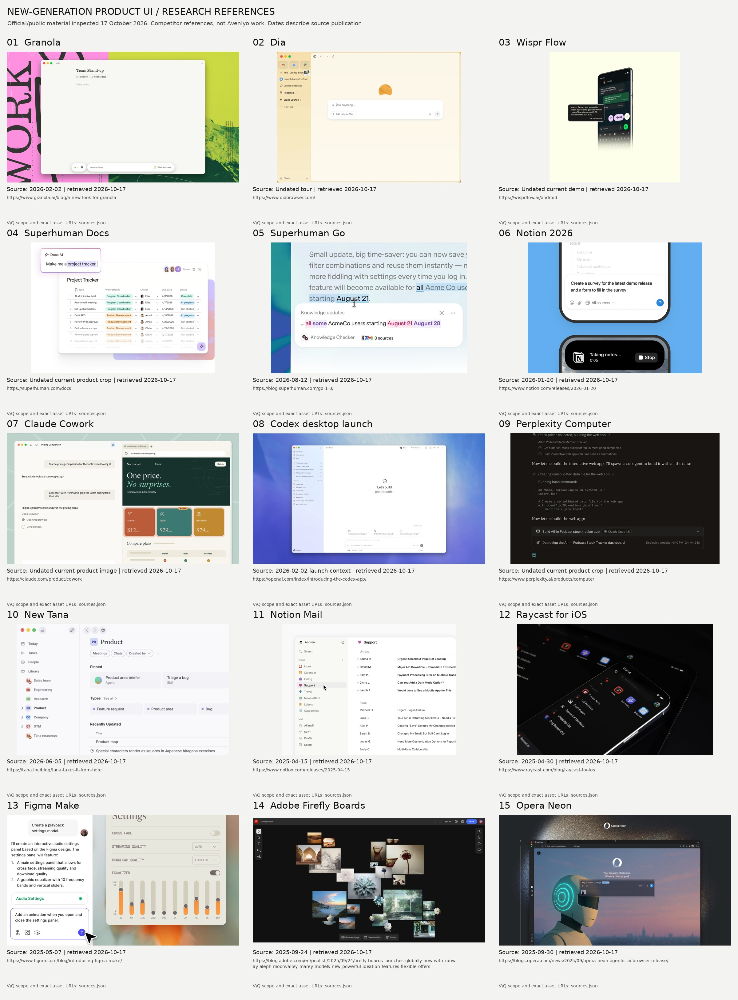

# New-generation product UI reference board

**Research references only — these are not Avenlyo designs.** Inspected 17 October 2026. All sources are official product material. No generated competitor mockups or inspiration galleries are included.

Use the individual images for reading; the contact sheet is an overview. Publication dates and launch dates are different fields. An undated current image is not proof of a particular release build. Demo frames do not establish native animation timings.

[Research report](../../docs/frontend-new-generation-research-v1.md) · [Exact asset/source manifest](sources.json) · [Contact sheet](contact-sheet.jpg)

| Product | Source publication | Image | Exact source page |
| --- | --- | --- | --- |
| Granola | 2026-02-02 | [01-granola.jpg](01-granola.jpg) | <https://www.granola.ai/blog/a-new-look-for-granola> |
| Dia | Undated tour | [02-dia.jpg](02-dia.jpg) | <https://www.diabrowser.com/> |
| Wispr Flow | Undated current demo | [03-wispr-demo.jpg](03-wispr-demo.jpg) | <https://wisprflow.ai/android> |
| Superhuman Docs | Undated current product crop | [04-docs-ui.jpg](04-docs-ui.jpg) | <https://superhuman.com/docs> |
| Superhuman Go | 2026-08-12 | [05-go-suggestions.jpg](05-go-suggestions.jpg) | <https://blog.superhuman.com/go-1-0/> |
| Notion 2026 | 2026-01-20 | [06-notion-mobile.jpg](06-notion-mobile.jpg) | <https://www.notion.com/releases/2026-01-20> |
| Claude Cowork | Undated current product image | [07-cowork2.jpg](07-cowork2.jpg) | <https://claude.com/product/cowork> |
| Codex desktop launch | 2026-02-02 launch context | [08-codex.jpg](08-codex.jpg) | <https://openai.com/index/introducing-the-codex-app/> |
| Perplexity Computer | Undated current product crop | [09-computer.jpg](09-computer.jpg) | <https://www.perplexity.ai/products/computer> |
| New Tana | 2026-06-05 | [10-tana.jpg](10-tana.jpg) | <https://tana.inc/blog/tana-takes-it-from-here> |
| Notion Mail | 2025-04-15 | [11-mail.jpg](11-mail.jpg) | <https://www.notion.com/releases/2025-04-15> |
| Raycast for iOS | 2025-04-30 | [12-raycast.jpg](12-raycast.jpg) | <https://www.raycast.com/blog/raycast-for-ios> |
| Figma Make | 2025-05-07 | [13-figma.jpg](13-figma.jpg) | <https://www.figma.com/blog/introducing-figma-make/> |
| Adobe Firefly Boards | 2025-09-24 | [14-firefly.jpg](14-firefly.jpg) | <https://blog.adobe.com/en/publish/2025/09/24/firefly-boards-launches-globally-now-with-runway-aleph-moonvalley-marey-models-new-powerful-ideation-features-flexible-offers> |
| Opera Neon | 2025-09-30 | [15-opera.jpg](15-opera.jpg) | <https://blogs.opera.com/news/2025/09/opera-neon-agentic-ai-browser-release/> |

## Reading limits

- **Granola:** Official redesign screenshot; campaign backdrop is outside the app.
- **Dia:** Official new-tab video poster; not a captured 2026 build or motion evidence.
- **Wispr Flow:** Official edited Android demo frame at 4.229 seconds; native latency unverified.
- **Superhuman Docs:** Official product UI crop, not the brand reel.
- **Superhuman Go:** Official edited suggestion demo frame at 8.38 seconds.
- **Notion 2026:** Official mobile Agent and recording state; not proof of complete mobile Home.
- **Claude Cowork:** Official browser/task screenshot; September unification is documented separately.
- **Codex desktop launch:** Official embedded launch-video thumbnail; poster only, no interaction inspection.
- **Perplexity Computer:** Official execution crop; complete shell not visible.
- **New Tana:** Official space home; distinct from Tana Outliner.
- **Notion Mail:** Official custom-view GIF, frame 30; launch reference.
- **Raycast for iOS:** Official angled Home imagery; exact geometry cannot be measured from it.
- **Figma Make:** Make prompt on the left; generated settings design on the right is output, not Make chrome.
- **Adobe Firefly Boards:** Official spatial board screenshot.
- **Opera Neon:** Official browser start screenshot; staged scene is not an Avenlyo proposal.

## Supplementary references

- [Notion agent sources/settings — notion-settings.jpg](notion-settings.jpg), 2026-02-24; <https://www.notion.com/releases/2026-02-24>.
- [Tana meeting create menu — tana-meeting.jpg](tana-meeting.jpg), 2026-06-05; <https://tana.inc/blog/tana-takes-it-from-here>.
- [Tana meeting digest/outcomes — tana-outcomes.jpg](tana-outcomes.jpg), 2026-06-05; <https://tana.inc/blog/tana-takes-it-from-here>.
- [Tana mobile — tana-mobile.jpg](tana-mobile.jpg), 2026-10-08; <https://tana.inc/blog/tana-app-for-ios>.
- [Raycast iOS AI — raycast-ai.jpg](raycast-ai.jpg), 2025-04-30; <https://www.raycast.com/blog/raycast-for-ios>.
- [Raycast iOS Notes — raycast-notes.jpg](raycast-notes.jpg), 2025-04-30; <https://www.raycast.com/blog/raycast-for-ios>.
- [Superhuman Docs AI demo — docs-ai-00s.jpg](docs-ai-00s.jpg), 2026-07-08; <https://blog.superhuman.com/introducing-superhuman-docs/>.
- [Superhuman Docs AI demo — docs-ai-09s.jpg](docs-ai-09s.jpg), 2026-07-08; <https://blog.superhuman.com/introducing-superhuman-docs/>.
- [Superhuman Docs AI demo — docs-ai-12s.jpg](docs-ai-12s.jpg), 2026-07-08; <https://blog.superhuman.com/introducing-superhuman-docs/>.
- [Superhuman Docs AI demo — docs-ai-15s.jpg](docs-ai-15s.jpg), 2026-07-08; <https://blog.superhuman.com/introducing-superhuman-docs/>.
- [Superhuman Docs AI demo — docs-ai-18s.jpg](docs-ai-18s.jpg), 2026-07-08; <https://blog.superhuman.com/introducing-superhuman-docs/>.

Copyright remains with the respective owners. These small reference copies support internal comparative analysis; they are not licensed production assets. Original URLs, retrieval dates, transformations and hashes are recorded in `sources.json`.
