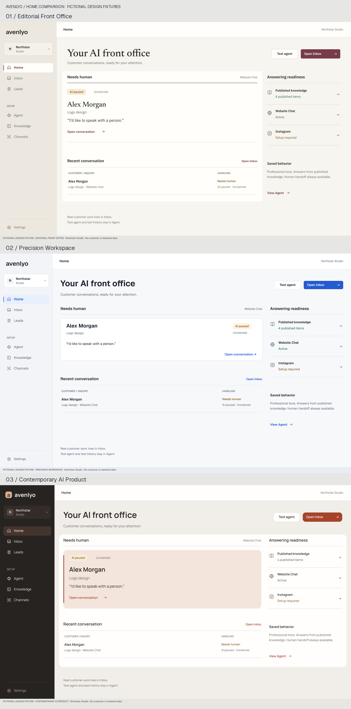

# Avenlyo visual directions v1

Visual review date: **17 October 2026**. Branch: `feat/frontend-recreation-v1`. Verified source HEAD: **`570ef1c2cfde754f975a10d63d5ce0ec47539545`**. Both approved source documents, [research](frontend-research-v1.md) and [wireframes](frontend-wireframes-v1.md), were read in full. Their product and UX constraints govern this study; their earlier visual recommendation does not.

**Recommendation: Direction 3 — Contemporary AI Product, as a complete system.** The charcoal frame, restrained terracotta, Manrope typography and shared treatment of supervision produce the strongest identity across the actual Home, Inbox, Agent and embedded widget compositions. This is a design judgment from the artifacts below, not stakeholder approval or a usability study. Direction 2 is the strongest alternative for maximum operational density.

**Design only.** No production application, API, database, migration, RLS, authentication, runtime, dependency, CI or route change. No merge, deployment or implementation PR. Do not implement the recommendation without a separate explicit approval.

**Stakeholder update:** Direction 3 is approved as the visual direction. The [Direction 3 refinement](#direction-3-refinement) below is design-only; implementation remains unapproved. Earlier specifications and scores describe the preserved original study.

## Review entry points

- [Offline review gallery](../design-prototypes/frontend-visual-directions/index.html): open directly; no server or build required.
- [All desktop compositions](../design-prototypes/frontend-visual-directions/boards/desktop-overview.png).
- [Home comparison](../design-prototypes/frontend-visual-directions/boards/comparison-home.png), [Inbox comparison](../design-prototypes/frontend-visual-directions/boards/comparison-inbox.png), [mobile comparison](../design-prototypes/frontend-visual-directions/boards/comparison-mobile.png).
- [Rendered typography comparison](../design-prototypes/frontend-visual-directions/mockups/typography-comparison.png).
- [Official reference contact sheet](../design-prototypes/frontend-visual-directions/boards/visual-references.png).
- [Machine-readable fixture](../design-prototypes/frontend-visual-directions/fixture.json), [tokens](../design-prototypes/frontend-visual-directions/tokens.json), [CSS token handoff](../design-prototypes/frontend-visual-directions/tokens.css), [validation](../design-prototypes/frontend-visual-directions/validation.json).

There are exactly **three directions**, **12 desktop compositions at 1440×900** and **6 mobile compositions at 390×844**. Every composition has an outlined SVG and a native-size PNG. SVG text is outlined from actual bundled fonts, so review does not depend on installed fonts or live font services. The HTML gallery is a local artwork viewer with small CSS motion demonstrations; it is not an app prototype connected to a backend. Rasterization uses `sharp`, not a browser screenshot. Static visual QA does not establish keyboard or production behavior.

## 1. Research update: targeted visual evidence

This research examines composition and visual hierarchy, rather than repeating the approved functional research. All sources below were retrieved on 17 October 2026. Captured official imagery is retained separately under `references/`, with exact page URLs, image URLs and retrieval date in [sources.json](../design-prototypes/frontend-visual-directions/references/sources.json). Resized copies are for review; original asset dimensions are recorded. No signed-in accounts or trials were used. An image cannot establish current live animation timings, hover behavior, responsive breakpoints or exact font families.

| Reference / exact URL | Publication context | Visually useful pattern | What must not be copied | Captured image |
| --- | --- | --- | --- | --- |
| [Linear: Priority inbox](https://linear.app/changelog/2026-09-03-priority-inbox) | 3 Sep 2026 changelog | Tight title/preview rhythm, low-noise list hierarchy, selective emphasis without a grid of cards | Priority classification, unread markers, avatars, dark developer-tool identity and its branded geometry | [linear-inbox.jpg](../design-prototypes/frontend-visual-directions/references/linear-inbox.jpg) |
| [Attio: Record page redesign](https://attio.com/changelog/2026/record-page-redesign) | 28 May 2026 release | Identity and actions share a stable anchor; fine panel boundaries; deliberate attribute grouping; varied weight carries hierarchy | Enrichment, CRM attributes, staff identities, resizing controls, timelines or actions unavailable in Avenlyo | [attio-record.jpg](../design-prototypes/frontend-visual-directions/references/attio-record.jpg) |
| [Intercom: Inbox](https://www.intercom.com/helpdesk/inbox) | Current official product page; image itself undated | Full navigation/list/thread/context proportions; composer belongs to the conversation; author roles remain readable in a restrained message system | Its additional channels, staff presence, macros, priority, SLA, avatar conventions and Copilot controls | [intercom-inbox.jpg](../design-prototypes/frontend-visual-directions/references/intercom-inbox.jpg) |
| [Front: New inbox experience](https://help.front.com/en/articles/3889728) | Guide edited 28 Aug 2026 | Compact sidebar rows, muted chrome, inset selected row and a thin selection edge; text matters more than icon decoration | Lavender identity, counts that imply unread work, Open/Later/Done taxonomy, team names or dual navigation rail | [front-inbox.jpg](../design-prototypes/frontend-visual-directions/references/front-inbox.jpg) |
| [Vercel: Navigation redesign rollout](https://vercel.com/changelog/dashboard-navigation-redesign-rollout) | 26 Feb 2026 changelog | Continuous white work plane; clear workspace scope; quiet dividers; small active-state contrast rather than full-page decoration | Deployment hierarchy, technical navigation, project filters, its mark and its exact sidebar | [vercel-shell.jpg](../design-prototypes/frontend-visual-directions/references/vercel-shell.jpg) |
| [Resend: Transactional emails](https://resend.com/products/transactional-emails) | Current official product page; screenshot undated | Compact list headers, restrained status text and localized state highlights; a little metadata can feel intentional | Global dark mode, email analytics, delivery claims, developer API navigation or dense data absent from Avenlyo | [resend-list.jpg](../design-prototypes/frontend-visual-directions/references/resend-list.jpg) |

The following are **design inferences from that evidence**, not claims about competitor implementation:

| Dimension studied | Resulting Avenlyo decision |
| --- | --- |
| Shell, sidebar and panel proportions | Labeled navigation stays fixed; real work gets master/detail; context remains subordinate. Compare 232/320/264, 216/312/260 and 224/320/272px systems below. |
| Typography, whitespace and density | Distinguish page introductions from operational headings. Keep low volume intentional through alignment and bounded sections, rather than invented charts or data. |
| Lists and selected states | One selected object gets a tint and rule. One conversation remains one conversation; no decorative ghost rows or fake unread dots. |
| Surfaces, borders and shadows | Use rules for boundaries, fills for work/state hierarchy, elevation only for overlays. Direction 3 groups related work in one large surface, not many equal cards. |
| Messages | Customer and Avenlyo are explicitly named; color and alignment support authorship. No avatars, receipts, typing or unsupported message actions. |
| Icons, buttons and forms | Small authored outline symbols, consistent strokes, restrained primary actions. Native form semantics would be required later; these drawings are not functional controls. |
| Color, focus and status | Distinct independently selected palettes. Operational status always has words; calculated pairs are documented in section 6. |
| Hover and transitions | Reference imagery does not prove behavior. Concrete proposed values appear in section 9, with CSS samples in the gallery. |
| Empty and loading states | Preserve the same shell and work-object dimensions. Absence of conversations is different from a failed fetch. |
| Mobile | List becomes a full-screen conversation; composer replaces bottom navigation; context would be a sheet. Widget becomes an inset, near-full-height surface. Static artwork cannot verify virtual keyboard behavior. |

## 2. Fixed fixture and product fidelity

All directions use Northstar Studio, Website Chat **Active**, Instagram **Setup required**, and **4 published knowledge items**. Active means the fixture has recorded past activity; it does not assert live installation monitoring. Alex Morgan, `alex@example.test`, Logo design and Qualified are fictional. The conversation is **Needs human / AI paused / Unclaimed** in every baseline view. No timestamps were supplied, so none were invented.

All six messages are reproduced verbatim in both Inbox sizes. The widget shows the latest four messages of that same fixture, with Load earlier messages representing the existing history action; the earlier pricing question/answer remain in `fixture.json`. This framing is identical in all directions. The customer website behind each desktop widget is also identical.

The Agent fixture selects all four supported goals, Professional tone, and Name/Email; Phone/Company are unselected. This is a consistent design fixture choice, not a production default or a discovered customer configuration. Effective behavior is a deterministic summary of those selections. Planning note stays secondary and explicitly is not sent to the answering AI. Test Agent and Test history remain secondary Agent tabs.

Inbox context displays only linked-lead name/qualification/link and current handling state. Email stays in the transcript. Logo design is visible in the conversation and Home fixture; the context does not invent an enriched contact/summary payload. No team message or staff notification was invented merely to fill the design.

Claim must pause/retain pause and assign the current member; a claim changes the linked lead to `needs_human`. Release removes ownership and **keeps AI paused**. Explicit Resume AI clears the claim and permits an answer to the **next customer message**; it does not answer the backlog or restore a prior qualification. The Qualified label here is the supplied **pre-claim** fixture, independently displayed from the handling state. Another member's active claim prevents takeover/resume. The visual study changes none of these semantics.

## 3. Direction 1 — Editorial Front Office

[Home](../design-prototypes/frontend-visual-directions/mockups/01-editorial-home-desktop.png) · [Inbox](../design-prototypes/frontend-visual-directions/mockups/01-editorial-inbox-desktop.png) · [Agent](../design-prototypes/frontend-visual-directions/mockups/01-editorial-agent-desktop.png) · [Widget](../design-prototypes/frontend-visual-directions/mockups/01-editorial-widget-desktop.png)

| System decision | Specification |
| --- | --- |
| 1. Philosophy | A composed business brief that becomes a practical conversation workbench. Content has weight; warmth is restrained. |
| 2. Mood | Mineral, literate, welcoming, established. The oxblood action color avoids inheriting either the old Avenlyo palette or the previous cobalt proposal. |
| 3. Palette | Ivory `#F7F5F0`, almost-white work `#FFFEFB`, stone navigation `#ECE8DF`, ink `#252923`, oxblood `#763C48`. |
| 4. Typography | IBM Plex Sans for UI/messages; Newsreader for introductions and the Home customer emphasis. No serif in Inbox controls or message bodies. |
| 5. Type scale | Home title 42/48, other introductions 38/44; display emphasis 29/36; section 16/24; UI 14/21; message 15/22; supporting text 12/18. |
| 6. App shell | 232px navigation, continuous content, 64px compact page chrome. Inbox consumes the remaining viewport. |
| 7. Sidebar | Light stone; inset white current destination, 2px oxblood rule, 44px destination rhythm; workspace box remains compact. |
| 8. Surfaces | Ivory frame with an almost-white editorial work field; no texture image or decorative paper grain. |
| 9. Panels | Home's main brief shares one unboxed reading field. Agent is four ruled sections; its single behavior summary is subordinate. |
| 10. Borders | 1px `#DAD7CD` pane/row rules; a stronger top rule anchors the Home brief. No border around every fact or AI reply. |
| 11. Shadows | No ordinary work-surface shadow. Overlay target `0 16px 48px rgba(37,41,35,.14)`; raster widget uses restrained two-step tonal underlay. |
| 12. Radius | 0 work fields; 4 status/checkbox; 5 controls; 8 message/selection; 10 overlays; 16 widget; circular 56px launcher. |
| 13. Icons | 18px nav, 16px inline, 20px channel symbols, 24px launcher; outline stroke 1.65 at a 24px source grid. |
| 14. Buttons | 38px desktop primary, weight 600; solid oxblood only for the current action; secondary white. Mobile primary 44px. |
| 15. Inputs | 40px standard target; true labels; 5px radius; mobile entry text 16px. Disabled human composer remains visibly gated by claim. |
| 16. Lists | 112px conversation base; 72px Knowledge target; 60px inquiry target. Current row has fill and a rule, with no unread signal. |
| 17. Messages | Customer stone bubbles; AI text on the open work plane, right aligned with an author label. This deliberately reduces framing, but needs careful role readability. |
| 18. Status | Text and pause/check symbols; success green is functional only. Oxblood denotes action rather than risk. |
| 19. Selected states | `#E9E0E1` object selection, ink text, separate 2px focus ring with 2px offset. Navigation uses its own white inset. |
| 20. Empty states | Keep the ruled brief and readiness ledger. Say No customer conversations yet, with channel guidance; never claim all caught up on a failed read. |
| 21. Mobile | Same type personality in labels; one full-screen thread; 16px side gutters; 44px primary claim. Navigation/composer change follows approved UX. |
| 22. Widget | Business-first white header, quiet AI disclosure, open AI text, oxblood customer bubbles and launcher. Premium through typography and restraint. |
| 23. Motion | Soft 180ms feedback, 220ms context, 240ms widget; no springs or ambient motion. Full map below. |
| 24. Why premium | Actual type contrast, precise rules, a deliberate reading measure and quiet operational chrome. The white brief field prevents a beige page from carrying the whole design. |
| 25. Biggest risk | Serif/ivory styling may still be mistaken for a familiar editorial template. Unboxed AI answers can look weak beside the more contained alternatives. |

## 4. Direction 2 — Precision Workspace

[Home](../design-prototypes/frontend-visual-directions/mockups/02-precision-home-desktop.png) · [Inbox](../design-prototypes/frontend-visual-directions/mockups/02-precision-inbox-desktop.png) · [Agent](../design-prototypes/frontend-visual-directions/mockups/02-precision-agent-desktop.png) · [Widget](../design-prototypes/frontend-visual-directions/mockups/02-precision-widget-desktop.png)

| System decision | Specification |
| --- | --- |
| 1. Philosophy | Make the work immediately legible with tightly controlled geometry and visual hierarchy. |
| 2. Mood | Crisp, assured, quick, familiar to business software users without becoming a console. |
| 3. Palette | Cool canvas `#F7F8FA`, white `#FFFFFF`, nav `#F2F4F7`, deep text `#192330`, confident blue `#245BD1`. |
| 4. Typography | Geist throughout. It was selected after rendering the alternatives, not because a font already existed in the app. |
| 5. Type scale | Home 34/42; Agent 32/40; section 16/24; operational identity 20/28; UI 14/20; message 14/22; supporting 12/18. |
| 6. App shell | 216px labeled sidebar; 312px list, 260px docked context, 652px remaining thread at 1440px. The widest thread of the three. |
| 7. Sidebar | Cool-gray single nav, white workspace block, small blue selected marker and light blue fill. No icon-only second rail. |
| 8. Surfaces | White work objects on a cool canvas; flat planes; no gradients, decorative top masthead or chart modules. |
| 9. Panels | Home's 172px compact handoff panel separates identity/inquiry from handling state. Recent work moves 56px higher than the other directions. Agent goals occupy a disciplined inset control column. |
| 10. Borders | 1px `#DFE4EA` rules; fine outline on AI messages and operational objects. Controls retain visible labels. |
| 11. Shadows | None on work panes; overlay target `0 8px 28px rgba(25,35,48,.12)`. |
| 12. Radius | 4 status/checkbox; 6 controls; 8 selected objects; 9 messages; 10 overlays; 12 widget. |
| 13. Icons | Same functional icon vocabulary, 18px navigation/16px inline. No extra symbols to make sparse data look busy. |
| 14. Buttons | 34px desktop baseline, 44px touch target; compact blue primary and quiet white secondary. |
| 15. Inputs | 36px standard desktop target, 6px radius; mobile entry text 16px; focus uses a separate 2px blue ring. |
| 16. Lists | 100px conversation base; 64px Knowledge target; 52px inquiry target. Compact rows still expose channel and ownership. |
| 17. Messages | Gray customer bubbles, white outlined AI messages. Boundaries remain visible at low contrast without competing with the message body. |
| 18. Status | Amber pause band, separate Unclaimed line, blue Claim action; green remains confirmation/qualification only. |
| 19. Selected states | Immediate `#E8EFFD` row fill with 2px blue rule. A focus ring never doubles as the selected marker. |
| 20. Empty states | Keep fixed panel headers and use one short empty explanation inside the list. Do not manufacture example rows. |
| 21. Mobile | Full-width single conversation, stable handling strip, fixed claim/composer region. Density comes from precise padding, not smaller tap targets. |
| 22. Widget | A compact business messenger with neutral header, blue customer bubbles, quiet borders and a circular launcher. |
| 23. Motion | 70ms press, 90ms feedback, 100ms new message, 160ms context, 180ms widget; identity and permission changes immediate. |
| 24. Why premium | Consistent alignment, clear state/action adjacency, clean message containment and controlled proportions. It remains coherent with exactly one conversation. |
| 25. Biggest risk | Blue, cool-gray, Geist and a standard multi-pane Inbox are a familiar SaaS family. This is the most operationally polished option, but the least distinctive as a brand. |

## 5. Direction 3 — Contemporary AI Product

[Home](../design-prototypes/frontend-visual-directions/mockups/03-ai-product-home-desktop.png) · [Inbox](../design-prototypes/frontend-visual-directions/mockups/03-ai-product-inbox-desktop.png) · [Agent](../design-prototypes/frontend-visual-directions/mockups/03-ai-product-agent-desktop.png) · [Widget](../design-prototypes/frontend-visual-directions/mockups/03-ai-product-widget-desktop.png)

| System decision | Specification |
| --- | --- |
| 1. Philosophy | Make supervision feel like a natural, distinctive product surface. AI identity comes from the handling boundary and readable controls. |
| 2. Mood | Confident, tactile, contemporary and approachable; a warm product with an anchored frame. |
| 3. Palette | Mineral `#F1EEEA`, porcelain `#FFFEFC`, charcoal `#272321`, terracotta `#A6442A`, peach selection `#F4E5DC`. |
| 4. Typography | Manrope for UI, messages and headings, with 650 weight for major titles. Stronger round forms give the otherwise practical layout personality. |
| 5. Type scale | Home 34/42, Agent 32/40; section 16/24; customer emphasis 25/32; UI 14/21; message 14.5/22; supporting 12/18. |
| 6. App shell | 224px charcoal sidebar, stable white page chrome; 320px conversation navigator, 272px context and a 624px thread. |
| 7. Sidebar | Dark business frame, light wordmark, compact warm workspace field; peach active text on a muted brown inset. The small a tile is a study mark, not a finalized new logo. |
| 8. Surfaces | Large porcelain planes on mineral canvas. Home and Agent group related work into one plane; only the paused item receives a stronger local layer. |
| 9. Panels | Rounded 18px continuous work field; Home's peach handoff object and Agent's deterministic summary are the two intentional inner emphasis treatments. No five-card settings stack. |
| 10. Borders | 1px `#DED8D1` where regions meet; surface fill does most grouping. No glass, neon, glow or repeated heavy outlines. |
| 11. Shadows | Ordinary planes none; overlay target `0 20px 56px rgba(43,39,37,.18)`. Widget raster has a modest two-step tonal shadow. |
| 12. Radius | 4 checkbox; 7 status; 12 controls; 15 messages; 18 work planes; 22 widget; 19 launcher corners. |
| 13. Icons | Same restrained outline set. The pause icon is contextual, never an animated AI emblem. |
| 14. Buttons | 38px desktop, solid terracotta primary; 44px mobile primary; almost-white secondary with quieter border. |
| 15. Inputs | 40px standard target; warm subtle fill and explicit label; 12px control radius; 16px mobile entry text. |
| 16. Lists | 108px conversation base; 72px Knowledge target; 60px inquiry target. Slightly more breathing room than Precision. |
| 17. Messages | Warm-gray customer bubbles, peach AI bubbles; text labels and opposing alignment retain role clarity. No imagined reasoning or AI activity animation. |
| 18. Status | Dark handling strip integrates AI paused with the human Claim action; Unclaimed stays a separate line. On mobile it simplifies to an explicit compact status strip. |
| 19. Selected states | Peach current-object fill with terracotta rule; sidebar selection is adapted to the dark frame. Neither selection nor orange implies urgency by itself. |
| 20. Empty states | Preserve the porcelain work plane; one calm empty explanation and next supported action. Keep readiness facts visible without a progress ring. |
| 21. Mobile | Dark desktop navigation yields to a light, single conversation view. The widget preserves its charcoal business header; no tiny permanent desktop sidebar. |
| 22. Widget | Charcoal business header, warm customer bubble, peach AI answer and a rounded-square terracotta launcher. Business name and honest AI disclosure lead. |
| 23. Motion | 90ms press, 140ms feedback, 160ms new message, 200ms context, 220ms widget; purposeful layered reveal with no overshoot. |
| 24. Why premium | A recognizable composition survives all four surfaces: anchored frame, soft work plane, carefully limited warm emphasis, human-scale type and explicit supervision. |
| 25. Biggest risk | Terracotta can be misread as warning; labels and separate amber attention tokens must remain consistent. Rounded layering can become card-heavy if extended carelessly. |

## 6. Token tables and color validation

These are actual design values. The handoff files are isolated artifacts; nothing in production imports them. `--border` is a decorative structural rule, not an accessible input boundary by itself. The input/checkbox boundary target is separately defined.

| Semantic token | 1 / Editorial | 2 / Precision | 3 / Contemporary |
| --- | --- | --- | --- |
| `--canvas` | `#F7F5F0` | `#F7F8FA` | `#F1EEEA` |
| `--surface` / `--surface-raised` | `#FFFEFB` | `#FFFFFF` | `#FFFEFC` |
| `--navigation` | `#ECE8DF` | `#F2F4F7` | `#272321` |
| `--surface-subtle` | `#F0EEE8` | `#F1F4F8` | `#F4F0EA` |
| `--text-primary` | `#252923` | `#192330` | `#2B2725` |
| `--text-secondary` | `#66675F` | `#596575` | `#69615C` |
| `--border` | `#DAD7CD` | `#DFE4EA` | `#DED8D1` |
| `--control-border` | `#858D96` | `#858D96` | `#858D96` |
| `--accent` / `--focus` | `#763C48` | `#245BD1` | `#A6442A` |
| `--accent-hover` | `#5C2934` | `#1748B0` | `#87341E` |
| `--selection` | `#E9E0E1` | `#E8EFFD` | `#F4E5DC` |
| `--success` / fill | `#326247` / `#EAF2E9` | `#256348` / `#E8F3ED` | `#426446` / `#ECF1E7` |
| `--attention` / fill | `#825018` / `#F8EBD4` | `#825016` / `#FFF2DC` | `#845119` / `#F9ECD6` |
| `--danger` / fill target | `#AE323B` / `#FCECEE` | `#B13442` / `#FCECEE` | `#B32F3B` / `#FCECEE` |
| Dark-frame text / muted | Not applicable | Not applicable | `#F5F0E9` / `#BFB4AC` |
| Dark handling text | Not applicable | Not applicable | `#F5D4BD` / `#D5C5B9` |
| Scrim target | `rgba(37,41,35,.24)` | `rgba(25,35,48,.24)` | `rgba(43,39,37,.28)` |

| Geometry / type token | 1 | 2 | 3 |
| --- | --- | --- | --- |
| `--font-ui` | `"IBM Plex Sans", system-ui, sans-serif` | `"Geist", system-ui, sans-serif` | `"Manrope", system-ui, sans-serif` |
| `--font-display` | `"Newsreader", Georgia, serif` | UI family | UI family |
| UI weights | 400 / 500 / 600 | 400 / 500 / 600 / title 650 | 400 / 500 / 600 / title 650 |
| Display weight | 500 | 650 | 650 |
| Title tracking target | `-.025em` | `-.03em` | `-.035em` |
| Body / label tracking | `0` | `0` | `0` |
| Spacing scale | `2,4,8,12,16,20,24,32,44,48,64px` | `2,4,8,12,16,20,24,32,40,48,64px` | `2,4,8,12,16,20,24,32,36,48,64px` |
| Radius scale | `0,4,5,8,10,16px` | `0,4,6,8,9,10,12px` | `0,4,7,12,15,18,22px` |
| Shadow | `0 16px 48px rgba(37,41,35,.14)` | `0 8px 28px rgba(25,35,48,.12)` | `0 20px 56px rgba(43,39,37,.18)` |
| Focus | 2px accent ring + 2px offset | Same geometry | Same geometry; light ring variant on dark surfaces requires implementation QA |

The outlined artwork preserves font glyph shape and native kerning. The tracking values above are **web implementation targets**, not an assertion that a CSS renderer was measured. Standard text uses actual font advances. Likewise overlay shadows are numerical handoff targets; static widget artwork uses simple tonal geometry to communicate elevation.

Calculated sRGB ratios, using `(Llight + .05) / (Ldark + .05)`:

| Critical pair | 1 | 2 | 3 |
| --- | --- | --- | --- |
| Body / surface | 14.66:1 | 15.86:1 | 14.68:1 |
| Muted / canvas | 5.25:1 | 5.58:1 | 5.24:1 |
| White / primary | 8.37:1 | 6.01:1 | 6.03:1 |
| White / primary hover | 11.53:1 | 8.11:1 | 8.27:1 |
| Focus / canvas | 7.68:1 | 5.66:1 | 5.22:1 |
| Body / selection | 11.42:1 | 13.74:1 | 12.04:1 |
| Success / success fill | 6.18:1 | 6.25:1 | 5.82:1 |
| Attention / attention fill | 5.73:1 | 6.11:1 | 5.67:1 |
| Danger / surface | 6.27:1 | 6.11:1 | 6.15:1 |

These pair tests do not certify the entire eventual interface. Actual focus, translucent overlays, hover variants, disabled controls and host integrations require later browser QA. Each important status has readable text, with an icon where helpful; green/orange/color alone never establishes state. Selected and focused are separate conditions. No contrast calculation changes production CSS.

## 7. Typography comparison

The [rendered board](../design-prototypes/frontend-visual-directions/mockups/typography-comparison.png) compares the same heading, action/state labels, body sentence and **İ ı Ş ş Ğ ğ Ç ç Ö ö Ü ü** at matching sizes. Glyph coverage is also checked directly in every font's Unicode cmap. All nine font files contain the complete Turkish set.

| Candidate | Result from actual rendering | Decision |
| --- | --- | --- |
| Inter | Very legible small UI and familiar proportions. Its familiarity does little to distinguish Avenlyo by itself. | Strong control comparison; not selected automatically. |
| Geist | Compact, clear state labels and a firm sans hierarchy; works particularly well in the 652px Precision thread. | Select for Direction 2. |
| IBM Plex Sans | Human character and a slightly narrower text rhythm; pairs with Newsreader without making operational text decorative. | Select for Direction 1 UI. |
| Manrope | Distinct rounded forms and confident headings; friendly without a novelty display font. Wider passages need controlled reading measure. | Select for Direction 3. |
| Instrument Sans | Balanced general UI face, especially good for the neutral fictional host site. Less distinctive than Manrope in the app comparison. | Use for the shared host, not an additional app direction. |
| System / SF-style stack | Zero webfont dependency, but platform-dependent character and metrics. Actual system-ui resolution here is DejaVu Sans; its rendered sample is explicitly labeled. | Practical fallback. SF itself was unavailable and is neither bundled nor falsely simulated. Check actual macOS/iOS rendering later. |
| Newsreader | Strongest editorial introduction at 38–42px while maintaining the Turkish sample's diacritics. | Select for Direction 1 display only. |
| Source Serif 4 | Readable, grounded and practical; slightly more institutional/heavy in the comparison heading. | Good alternative, not used in a fourth direction. |
| Instrument Serif | Memorable, narrow display texture; less robust for small UI labels and repeated operational text. | Reject for working UI and this editorial pairing. |

Font binaries and notices are under `assets/fonts/`. The eight webfont families come from the Google Fonts source repository with their SIL Open Font License notices; exact URLs are in `assets/fonts/sources.json`. The Linux system sample is DejaVu Sans with its own bundled license. A system/SF-style web fallback would be `system-ui, -apple-system, BlinkMacSystemFont, "Segoe UI", sans-serif`; this does not grant or require redistribution of SF.

[Inter official source](https://rsms.me/inter/) · [Geist official source](https://vercel.com/font) · [IBM Plex official source](https://github.com/IBM/plex) · [Google Fonts source repository](https://github.com/google/fonts).

## 8. Density comparison

All measurements are in CSS pixels at the specified native viewport. Base rows grow for an actual delivery issue; no error is clipped just to preserve density. Knowledge/inquiry targets are specified for coherence but those secondary screens were deliberately not designed in this session.

| Measurement | 1 / Editorial | 2 / Precision | 3 / Contemporary |
| --- | --- | --- | --- |
| Sidebar | 232 | 216 | 224 |
| Conversation list | 320 | 312 | 320 |
| Context | 264 | 260 | 272 |
| Remaining desktop thread | 624 | 652 | 624 |
| Conversation row base | 112 | 100 | 108 |
| Knowledge row target | 72 | 64 | 72 |
| Inquiry row target | 60 | 52 | 60 |
| Desktop button baseline | 38 | 34 | 38 |
| Standard input target | 40 | 36 | 40 |
| Message font / line height | 15/22 | 14/22 | 14.5/22 |
| Mobile message font / line height | 13.5/20 | 13.5/20 | 13.5/20 |
| Mobile entry text | 16 | 16 | 16 |
| Content page gutter | 44 | 32 | 36 |
| Thread inner gutter | 28 | 28 | 28 |
| Mobile thread gutter | 16 | 16 | 16 |
| Mobile primary target | 44 | 44 | 44 |
| Widget desktop panel | 376×674 | 376×674 | 376×674 |
| Widget mobile panel | 374×818; 8px inset | Same | Same |
| Agent content measure | 1040 | 1040 | 1040 |

The 674px desktop widget is an intentional visual exploration beyond the earlier 600px proposal. It permits a readable four-message handoff excerpt, current status and composer at 1440×900. Its later responsive implementation must cap height to the available viewport rather than force this size on small laptops. The mobile 818px panel leaves an 18px study label in this artwork; production safe-area geometry is a remaining implementation review, not a new widget feature.

Precision saves room through a smaller shell, smaller controls and tighter Home task, rather than invented metadata. Contemporary uses more surface distinction with only 28px less thread width. Editorial deliberately spends more space on reading rhythm. None depends on multiple customers or charts to appear intentional.

## 9. Motion comparison and boards

These are authored motion specifications. Exact timings were **not** reverse-engineered from competitor screenshots. The gallery's three local context samples demonstrate timing and easing only; they never simulate real ownership changes. All movement is removed under `prefers-reduced-motion: reduce`.

Curves: Editorial **E** = `cubic-bezier(.22,.61,.36,1)`; Precision **P** = `cubic-bezier(.2,0,.2,1)`; Contemporary **C** = `cubic-bezier(.16,1,.3,1)`. Reverse/exit: same curve, 150/110/140ms respectively. Do not wait for animation to establish focus or update permission.

| Event | Editorial | Precision | Contemporary | Shared guard |
| --- | --- | --- | --- | --- |
| Sidebar selection | Marker immediate; color 180ms E, 0px | Immediate; color 90ms P, 0px | Immediate; color 140ms C, 0px | No sliding nav indicator across unrelated destinations. |
| Conversation selection | 0ms | 0ms | 0ms | Clear previous identity/composer immediately; no customer crossfade. |
| New persisted message | 180ms E, 3px→0, opacity 0→1 | 100ms P, same | 160ms C, same | Only newly saved messages; history is immediate. Do not force scroll while reading history. |
| Context opening | 220ms E, 12px→0, opacity 0→1 | 160ms P, same | 200ms C, same | User requested; docked layout changes can be immediate. |
| Claim confirmed | 0ms state/focus | 0ms | 0ms | After server confirmation only; AI stays paused; qualification refreshes. |
| AI paused | 0ms text/icon | 0ms | 0ms | No pulse, glow or simulated reasoning. |
| Resume AI | 0ms text/icon | 0ms | 0ms | State after confirmation; explain next-message effect. |
| Drawer | 220ms E, 12px, opacity 0→1 | 160ms P, same | 200ms C, same | Focus containment where modal; Escape and focus restoration later require browser verification. |
| Modal | 180ms E, 4px→0, opacity 0→1 | 120ms P, same | 180ms C, same | Scrim opacity 0→1 in the same duration; no background scale. |
| Widget opening | 240ms E, 8px→0, opacity 0→1 | 180ms P, same | 220ms C, same | Desktop non-modal; mobile semantics and keyboard need separate QA. |
| Button press | 80ms color only | 70ms color only | 90ms color only | 0px movement, scale 1, opacity 1. |

Hover uses the sidebar feedback duration and a surface-color change only. Form selection is instant. Errors, pending labels, ownership restrictions and focus are immediate. No page-wide motion, staggered history, animated counts, particles or continuous shimmer.

Boards: [Editorial](../design-prototypes/frontend-visual-directions/mockups/01-editorial-motion-board.png) · [Precision](../design-prototypes/frontend-visual-directions/mockups/02-precision-motion-board.png) · [Contemporary](../design-prototypes/frontend-visual-directions/mockups/03-ai-product-motion-board.png).

## 10. Desktop mockup index

Every listed PNG is 1440×900. A matching `.svg` with the same basename is included beside it. Shell, workspace, navigation, selection, complete thread and context are visible where applicable.

| Direction | Home | Inbox | Agent | Website widget |
| --- | --- | --- | --- | --- |
| 1 | [01-editorial-home-desktop.png](../design-prototypes/frontend-visual-directions/mockups/01-editorial-home-desktop.png) | [01-editorial-inbox-desktop.png](../design-prototypes/frontend-visual-directions/mockups/01-editorial-inbox-desktop.png) | [01-editorial-agent-desktop.png](../design-prototypes/frontend-visual-directions/mockups/01-editorial-agent-desktop.png) | [01-editorial-widget-desktop.png](../design-prototypes/frontend-visual-directions/mockups/01-editorial-widget-desktop.png) |
| 2 | [02-precision-home-desktop.png](../design-prototypes/frontend-visual-directions/mockups/02-precision-home-desktop.png) | [02-precision-inbox-desktop.png](../design-prototypes/frontend-visual-directions/mockups/02-precision-inbox-desktop.png) | [02-precision-agent-desktop.png](../design-prototypes/frontend-visual-directions/mockups/02-precision-agent-desktop.png) | [02-precision-widget-desktop.png](../design-prototypes/frontend-visual-directions/mockups/02-precision-widget-desktop.png) |
| 3 | [03-ai-product-home-desktop.png](../design-prototypes/frontend-visual-directions/mockups/03-ai-product-home-desktop.png) | [03-ai-product-inbox-desktop.png](../design-prototypes/frontend-visual-directions/mockups/03-ai-product-inbox-desktop.png) | [03-ai-product-agent-desktop.png](../design-prototypes/frontend-visual-directions/mockups/03-ai-product-agent-desktop.png) | [03-ai-product-widget-desktop.png](../design-prototypes/frontend-visual-directions/mockups/03-ai-product-widget-desktop.png) |

## 11. Mobile mockup index

Every listed PNG is 390×844, with a matching portable `.svg`. All six Inbox messages fit the unclaimed conversation view; the claim action gates the human composer. Widget artwork displays the same latest-four excerpt as desktop.

| Direction | Inbox conversation | Widget open |
| --- | --- | --- |
| 1 | [01-editorial-inbox-mobile.png](../design-prototypes/frontend-visual-directions/mockups/01-editorial-inbox-mobile.png) | [01-editorial-widget-mobile.png](../design-prototypes/frontend-visual-directions/mockups/01-editorial-widget-mobile.png) |
| 2 | [02-precision-inbox-mobile.png](../design-prototypes/frontend-visual-directions/mockups/02-precision-inbox-mobile.png) | [02-precision-widget-mobile.png](../design-prototypes/frontend-visual-directions/mockups/02-precision-widget-mobile.png) |
| 3 | [03-ai-product-inbox-mobile.png](../design-prototypes/frontend-visual-directions/mockups/03-ai-product-inbox-mobile.png) | [03-ai-product-widget-mobile.png](../design-prototypes/frontend-visual-directions/mockups/03-ai-product-widget-mobile.png) |

## 12. Comparison board

Compare the same work rather than three different product concepts. The master/detail architecture, data, actions and baseline state are constant. Sidebar widths, reading character, task density, message containment, surface hierarchy and motion character vary deliberately.



[Open full-resolution Inbox comparison](../design-prototypes/frontend-visual-directions/boards/comparison-inbox.png) · [Open full-resolution mobile comparison](../design-prototypes/frontend-visual-directions/boards/comparison-mobile.png).

## 13. Evaluation scores

Scores are **author review judgments**, 1–10, after rendering and inspecting the artwork. They are not customer research, competitor ratings or measured conversion outcomes. Weighted total is `Σ(score × criterion weight)`; no extra brand bonus or hidden criterion is applied.

| Criterion | Weight | Editorial | Precision | Contemporary |
| --- | --- | --- | --- | --- |
| Perceived product quality | 25% | 8 | 9 | 9 |
| Operational clarity | 20% | 8 | 9 | 9 |
| Trust | 15% | 9 | 9 | 9 |
| Visual distinctiveness | 15% | 8 | 7 | 9 |
| Information density | 10% | 8 | 9 | 8 |
| Business-owner approachability | 10% | 9 | 8 | 9 |
| Implementation feasibility | 5% | 9 | 10 | 9 |
| **Weighted total / 10** | **100%** | **8.30** | **8.65** | **8.90** |

Editorial loses quality/clarity points because unboxed AI messages and the large literary emphasis feel less contained in the Inbox. Precision earns the strongest density and feasibility marks: its 652px thread and fine ruled system are straightforward. Its distinctiveness score reflects the familiar blue/gray SaaS family in the actual screenshots. Contemporary earns the same operational and trust scores as Precision because state and action remain explicit, but adds a recognizable identity across the app and widget. It sacrifices one density point and one feasibility point for wider letterforms and more surface states. A quarter-point lead is a recommendation to review, not a claim of objective superiority.

## 14. Red-team critique

| Challenge | Editorial | Precision | Contemporary |
| --- | --- | --- | --- |
| Why could this still be called generic? | Editorial serif plus ivory is an established visual family. | Blue/gray master-detail software is a familiar default. | A dark sidebar plus rounded warm panels is also a known contemporary pattern. |
| Why could it look weak beside Linear/Stripe/Attio? | Open AI text can lose object definition; serif does not solve operational polish. | It is orderly but less memorable; static artwork cannot prove fast real interactions. | Too many warm layers at scale could reduce contrast between normal and exceptional work. |
| Where does it risk looking like a template? | The Home title and reading field, if copied unchanged onto every page. | Workspace selector, blue button and outlined-message treatment. | The small a tile, peach task field and rounded large plane, if repeated indiscriminately. |
| Where does identity actually come from? | Newsreader/Plex pairing, oxblood actions, ruled editorial composition. | Tight geometry, Geist rhythm, compact task and state/action precision. | Charcoal anchor, terracotta/porcelain relationship, Manrope and supervision as the visual emphasis. |
| Enough density? | Yes for early owners; the 112px master row is deliberately comfortable. | Yes; 100px list rows and 34px controls are the strongest operating density. | Yes; the four-pane width still leaves 624px for the actual thread. |
| Too much density? | No in this fixture; smaller laptops may need closed context. | Potentially for inexperienced owners or large accessibility text; avoid shrinking touch targets. | Not here; rounded messages and wide Manrope can make long transcripts taller. |
| Does low volume look intentional? | The white ruled brief has a start/end instead of empty KPI boxes. | The compact task and bounded recent row finish the work without invented data. | One large work plane makes a single item feel considered; do not enlarge it further to fill the screen. |
| Does Inbox feel like the heart? | Yes structurally, but visual AI-message containment is the weakest option. | Yes; thread width and handling strip give the strongest operational emphasis. | Yes; dark pause/claim band makes supervision clear without an AI animation. |
| Does Agent read as an operating brief? | Yes; four flat numbered sections and a deterministic summary. | Yes; goal controls are deliberately aligned as an inset operating column. | Yes; one continuous work plane and a warm summary, not a settings-card stack. |
| Does the widget belong on another site? | Restrained header works well, though the open AI text can feel plain. | Clean and safe; strongest familiarity, lowest own-brand distinction. | Strongest signature while the business name stays first; dark header must be checked against dark host sites later. |

No direction earns a free pass from the original stakeholder criticism. The comparison uses static data only. Real premium quality will also depend on exact hover/focus, loading, keyboard, ownership conflict and mobile keyboard behavior in a later implementation session.

## 15. Recommended direction and remaining decisions

### Recommend Direction 3 as the complete system

1. **It looks stronger across the actual set.** `03-ai-product-home-desktop` groups a small amount of work into one deliberate porcelain surface; the peach human-needed item establishes hierarchy without metrics. `03-ai-product-inbox-desktop` carries that character into the most important screen while showing the entire six-message exchange, context and disabled composer.
2. **Its identity survives beyond a headline.** The charcoal sidebar, terracotta decisions, warm-gray/peach message relationship and Manrope lettering reappear in Agent and the public widget. Direction 1 relies more on serif introductions; Direction 2 relies more on familiar blue/gray conventions.
3. **It fits a supervised front office.** The dark handling band anchors Needs human, AI paused, Unclaimed and Claim conversation together. The visual identity comes from accountable control, not invented AI reasoning, orbs or workflows.
4. **Trust has concrete evidence.** The visitor sees Northstar Studio first and an explicit AI disclosure, followed by the same honest handoff language. The owner sees a gated human composer and a separate next-message Resume AI explanation. No avatar, availability promise, fake score or qualification change is hidden in decoration.
5. **It can absorb product complexity.** The unchanged master/detail architecture, consistent fact groups and 624px thread can accommodate real longer content. Complexity would enter existing lists and contextual disclosures rather than require a new conceptual navigation system. Context must overlay at smaller widths instead of crushing the thread.
6. **Implementation risk is acceptable.** The visual system needs ordinary CSS layout, colors, radii, typography and limited opacity/transform transitions. No new animation framework, API, schema, service or routing capability is implied. The serious later risks remain the already-audited ownership, retry and widget boundaries; this session does not touch them.

**Borrowed elements: none.** Do not turn this recommendation into a vague hybrid. Shared product architecture and fixture content are comparison controls, not borrowed visual details.

### Remaining visual decisions

| Decision | Current recommendation / remaining validation |
| --- | --- |
| Stakeholder direction selection | Review the native Inbox, Home and widget PNGs before approving any implementation. No direction is approved by this report itself. |
| Small a study mark | Keep the wordmark treatment for this comparison; decide separately whether the small tile should become a permanent brand mark. |
| Terracotta and attention | Retain separate amber attention tokens; test focus/hover/error combinations, especially on dark surfaces. |
| Mobile message size | Artwork uses 13.5/20 to expose the whole comparison fixture. Test 14–15px on physical devices and prefer readable scroll over squeezing history. |
| Default context | Docked here because comparison requires context visible. Initial product default remains closed unless explicitly approved otherwise. |
| Widget height | Validate 674px exploration against 600px/short laptop viewports; use available-height caps and real keyboard testing later. |
| Dark host integration | The neutral host is deliberately identical here. Review the chosen widget against dark and saturated client sites before implementation sign-off. |
| Font loading/fallback | Self-host only the selected required faces and retain licenses. Test actual macOS/iOS system fallback, Turkish text and layout shift. |
| Focus and mobile sheets | Static drawings do not prove focus restoration, modal semantics, safe areas or keyboard access; require real browser QA in implementation. |
| Empty/loading/error/membership states | Specifications exist; expand visual state coverage only after direction selection, retaining current backend truth. |

## Delivery, reproduction and scope audit

Files created are this report and the isolated `design-prototypes/frontend-visual-directions/` tree. The approved source research documents remain unchanged. Artwork includes 18 baseline SVG/PNG pairs, a typography board, three motion boards, Home/Inbox/mobile comparison boards, desktop overview, six attributed reference captures, font binaries/notices, fixture/tokens, a gallery and design-generation/review scripts.

To regenerate the design artwork in a compatible authoring environment:

```sh
python3 design-prototypes/frontend-visual-directions/build.py
node design-prototypes/frontend-visual-directions/render.mjs
python3 design-prototypes/frontend-visual-directions/review.py
```

Python needs Pillow and fontTools; Node needs sharp. Those were available in the authoring runtime. No repository dependencies were added or changed. Generated PNGs and outlined SVGs require none of these tools to view.

Validation performed: all 18 image dimensions; Turkish cmap coverage for nine fonts; shared baseline state/content labels; critical contrast calculations; visual inspection of the desktop overview, mobile comparison, typography board, references and representative full-resolution screens. A mobile bubble wrapping issue was corrected and rerendered. All baseline fixture states remain unchanged. Static SVG/HTML references were checked for broken local links. The gallery contains no network requests, production imports or backend calls. Its external source links are ordinary user-initiated navigation.

Production tests were not run because no production code changed. This work does not claim live browser interaction, provider, backend, runtime or accessibility acceptance. The final git diff must contain only the report and design-only tree. Commit and artifact locations are reported separately after packaging.

**Stop here. Do not implement, merge or deploy the recommended direction.**

## Direction 3 refinement

The stakeholder approved **Direction 3 — Contemporary AI Product** as the visual direction on 17 October 2026, then requested this final design-only refinement. The charcoal navigation, terracotta decision accent, Manrope, warm neutral/porcelain frame, supervision-focused handling strip, 224/320/624/272px Inbox geometry and widget identity are retained. No visual elements are borrowed from Directions 1 or 2. Original artwork and the original three-direction review remain unchanged; the tables above are historical baseline specifications, superseded only for the new refined set by the values below.

[Refinement gallery](../design-prototypes/frontend-visual-directions/refinement-v1/index.html) · [Before/after board](../design-prototypes/frontend-visual-directions/refinement-v1/comparison-direction3-before-after.png) · [Exact tokens](../design-prototypes/frontend-visual-directions/refinement-v1/tokens-refined.css) · [Measurements and validation](../design-prototypes/frontend-visual-directions/refinement-v1/validation-refinement.json).

### Color and surface changes

Ordinary content now uses neutral mineral fills. Selection has a restrained warm wash and a terracotta rule; human attention has explicit text/amber; primary actions retain the original terracotta. The dark handling strip stays in place. The widget keeps its charcoal business header, terracotta Send/launcher and softer geometry, while ordinary visitor/AI messages become quieter.

| Token / role | Original | Refined |
| --- | --- | --- |
| `--ai-fill` / Inbox and widget AI messages | `#F4E5DC` | `#F2F0EB` |
| `--customer-fill` / Inbox customer messages | `#F4F0EA` | `#F4F1EC` |
| `--selection` / Inbox current row and selected tone | `#F4E5DC` | `#EDE6DF` |
| `--home-attention-fill` | `#F4E5DC` | `#F1E9E2` |
| `--summary-fill` / Agent effective behavior | `#F4E5DC` | `#F4F1EC` |
| `--widget-customer-fill` | `#A6442A` | `#E6E1D9` |
| Widget customer text | `#FFFFFF` | `#2B2725` |
| `--handling-text` | `#F5D4BD` | `#E8DDD2` |
| `--handling-muted` | `#D5C5B9` | `#D8D1CB` |
| Accent / hover / navigation / canvas / surface | `#A6442A` / `#87341E` / `#272321` / `#F1EEEA` / `#FFFEFC` | Unchanged |

**Warm color exposure falls approximately 22.3% across the six matched views.** This is an area-weighted warm-chroma measurement: sum `R−B` for pixels satisfying `R≥G≥B`, using the same complete canvases before/after. It is not a claim that colored-pixel area fell 22.3%, nor a perceptual/usability score. Widget changes contribute most because ordinary messages previously used solid terracotta. The original action hue remains intact. New contrast pairs include body/AI **12.99:1**, body/widget-customer **11.37:1**, muted/AI **5.32:1**, and white/primary **6.03:1**.

### Radius changes

| Surface / token | Original → refined |
| --- | --- |
| Home main plane / `--radius-work` | 18 → 10px |
| Home needs-human object / `--radius-home-attention` | 14 → 8px |
| Agent main plane / `--radius-work` | 18 → 10px |
| Agent summary / `--radius-summary` | 15 → 8px |
| Inbox selected row / `--radius-selected-row` | 12 → 6px |
| Inbox message / `--radius-inbox-message` | 15 → 10px |
| Inbox composer / `--radius-composer` | 12 → 8px |
| Operational small controls / `--radius-control` | 12 → 10px |
| Flat Inbox/context work planes | 0px, unchanged |
| Widget panel / message / controls / launcher | 22 / 15 / 12 / 19px, unchanged |

The large operational fields are more square; the widget deliberately remains softer. No new cards, shadows or containers were added.

### Density changes

Density is gained from padding and spacing, with **no font-size or line-height reductions**. Desktop Inbox remains **14.5/22px**; mobile Inbox remains **13.5/20px**. Widget messages remain **14/20px**, mobile entry text **16px**. Mobile primary buttons remain **44px high**; desktop Claim remains **38px high**. Existing icon geometry is retained, with the same 44px mobile hit-area intent; static artwork does not verify live hit testing.

| Measurement | Original → refined | Capacity gain (`before/after−1`) |
| --- | --- | --- |
| Conversation row | 108 → 96px | 12.50% |
| Desktop handling strip | 81 → 72px | 12.50% |
| Desktop six-message stack | 473 → 429px | 10.26% |
| Context fact stack, first label to final helper end | 500 → 441px | 13.38% |
| Desktop composer footprint | 130 → 116px | 12.07% |
| Mobile handling strip | 65 → 57px | 14.04% |
| Mobile six-message stack | 470 → 424px | 10.85% |
| Mobile composer footprint | 110 → 98px | 12.24% |

Concrete spacing tokens: message gap **13→9px desktop / 8→6px mobile**; author-to-bubble offset **19→17px**; total bubble vertical padding **16→14px desktop / 16→12px mobile**. Widget spacing is unchanged. Freed space remains available for real longer histories; no extra fixture messages or metadata were invented.

### Updated artwork and validation

| Desktop, 1440×900 | Mobile, 390×844 |
| --- | --- |
| [Home](../design-prototypes/frontend-visual-directions/refinement-v1/mockups/03-ai-product-refined-home-desktop.png) | [Inbox conversation](../design-prototypes/frontend-visual-directions/refinement-v1/mockups/03-ai-product-refined-inbox-mobile.png) |
| [Inbox](../design-prototypes/frontend-visual-directions/refinement-v1/mockups/03-ai-product-refined-inbox-desktop.png) | [Widget open](../design-prototypes/frontend-visual-directions/refinement-v1/mockups/03-ai-product-refined-widget-mobile.png) |
| [Agent](../design-prototypes/frontend-visual-directions/refinement-v1/mockups/03-ai-product-refined-agent-desktop.png) | |
| [Widget](../design-prototypes/frontend-visual-directions/refinement-v1/mockups/03-ai-product-refined-widget-desktop.png) | |

Each new PNG has a matching portable outlined SVG. The 2952×4028 before/after board compares Home, Inbox, desktop widget and both mobile views; the gallery also pairs Agent. All use the original fictional Northstar Studio data, transcript and unclaimed/paused state. Claim/release/resume semantics and lead qualification behavior are unchanged. Original images are retained and their hashes recorded; Directions 1 and 2 are untouched.

Validation covers six image sizes, fixture/state labels, unchanged message sizes, 44px mobile primary artwork, contrast, measured spacing/color changes and visual inspection of all six renders and the board. This remains static visual validation, without a production browser, keyboard, runtime or backend acceptance claim. **No implementation, production styles/components, dependencies, merge or deployment is authorized or performed. Stop for stakeholder approval.**
