# Avenlyo: Derin UI/UX araştırması

**18 Ekim 2026 | Tasarım araştırması, görsel analiz ve karar çerçevesi**

Repo: `ismet3547/avenlyo-app` · Branch: `feat/frontend-rebuild-v2`
Ürün sözleşmesi tabanı: `ed945629cfe04b7097c6a94e8699603f2b9b5792`

## 01. Araştırmanın sonucu

**Avenlyo'nun tasarım odağı, müşteri işini anlamaktan güvenle müdahale etmeye geçiş olmalı.** Ekranın karakteri; neyin görünür kaldığı, kontrolün nasıl el değiştirdiği ve kullanıcının işine nasıl döndüğüyle kurulmalı.

Bu araştırma için 12 ürün/yüzey kapsamı seçildi: Intercom/Fin, Front, Linear, Attio, Granola, Dia, Wispr Flow, Superhuman Docs, Superhuman Go, Notion Agent, yeni Tana ve birleşik Claude deneyimi. Bunlar evrensel bir başarı sıralaması değildir. Seçim, Avenlyo'nun konuşma, bilgi, yapılandırma, mobil müdahale ve AI kontrolü problemlerine katkılarına dayanır.

Ana öneriler:

- Konuşma kimliği, AI durumu, yanıt yetkisi ve gönderim sonucu temel çalışma yüzeyinde bulunmalı.
- Ayrıntıların görünürlüğü, kullanıcının yaptığı işe göre değişmeli. Ekranın her durumunda aynı sütunlar açık kalmamalı.
- Kurulum, bilgi yayımlama ve günlük müşteri işi farklı dikkat düzenleri gerektiriyor.
- Marka karakteri; tipografi, oran, dil, yüzey ve tutarlı etkileşimle kurulmalı. Renk tek başına yenilik ölçütü olmamalı.
- Önce iki farklı çalışma modeli görevlerle karşılaştırılmalı: konuşma odaklı alan ve konuşmanın kuyruk içinde açıldığı alan.
- Nihai başarı; doğru müşteriye, doğru yetkiyle, sonucunu anlayarak müdahale etmektir. Görsel beğeni ayrıca ölçülmeli.

## 02. Önceki rapora eklenen derinlik

[İlk araştırma](frontend-rebuild-research-v2.md) mevcut ekranları, route'ları, veri sınırlarını ve frontend teknolojisini haritaladı. Bu belge o envanteri tekrar etmek yerine görsel kararların gerekçesini, insan-AI kontrolünü, karşı örnekleri ve nasıl doğrulanacaklarını derinleştirir.

Yeni katkılar: 12 resmî görselin ayrı ayrı incelenmesi; 2026 ürün değişikliklerinin okunması; CHI insan-AI etkileşim araştırmasıyla eşleştirme; sürekli görünür / isteğe bağlı / yeni özellik ayrımı; mikro metinler; mobil ve tipografi inceleme planı; kararları yanlışlayabilecek test protokolü.

## 03. Yöntem, kanıt ve araştırma soruları

### Kanıt anahtarı

| Kod | Anlam | Kanıtlamadığı şey |
| --- | --- | --- |
| K | Repo kaynak kodu ve mevcut veri/işlem sözleşmesi | Canlı kullanım başarısı veya hızı. |
| V | Görsel olarak incelenmiş resmî statik görüntü / demo karesi | Tüm ürün, odak davranışı veya animasyonun hissi. |
| D | Resmî yardım, makale, sürüm notu veya araştırma yayını | Özelliğin bu turda elle denendiği. |
| H | Avenlyo için araştırmacı hipotezi / tasarım önerisi | Kullanıcılarla doğrulanmış sonuç. |

Görseller, aynı reponun önceki araştırma branchindeki kaynak kaydı bulunan kopyalardan alındı. İlk edinim tarihleri 17 Ekim; bu turdaki inceleme 18 Ekim 2026. Yeni kaynak sayfaları bu turda tekrar okundu veya ilk kez incelendi. Statik görseller güncel uygulamanın eksiksiz kaydı sayılmadı. Görsel dosyalarının hash'leri, kaynakları ve kullanım sınırları [kanıt manifestinde](research/uiux-2026-10-18/evidence.json) yer alır.

Bu turda rakip hesaplarıyla oturum açılmadı, müşteri görüşmesi yapılmadı ve Avenlyo'nun çalışan sürümü ölçülmedi. Bulgular masa başı araştırması, kaynak kodu ve resmî görsel incelemesidir. Kaynakların pazarlama iddiaları ölçülmüş performans verisi olarak kullanılmadı.

### Cevap aranan sorular

1. Bir iş açıldığında kullanıcı önce neyi algılamalı: uygulama haritasını, müşteriyi veya bekleyen işlemi mi?
2. Hangi kontrol görünür kalmazsa kullanıcı hatırlamak veya aramak zorunda kalır?
3. AI'ın etkinliği, insan sahipliği ve talep niteliği nasıl ayrışmalı?
4. Kaydetme, yayımlama, devralma ve sürdürme neyi değiştirdiğini nasıl anlatmalı?
5. Bir konuşmadan diğerine geçerken kimlik, taslak ve okuma konumu nasıl korunmalı?
6. Aynı iş 1440px masaüstünde ve klavyesi açık telefonda nasıl tamamlanmalı?
7. Görsel karakter kullanım sırasında nasıl hissedilir; yalnızca lansman görselinde nasıl göründüğüyle nasıl ayrılır?
8. Hangi tasarım kararı mevcut veriyle uygulanabilir, hangisi yeni ürün yeteneği gerektirir?

### On iki inceleme ekseni

Odak ve ilk bakış; navigasyon; içerik hiyerarşisi; iş yoğunluğu; birincil işlem; durum ve yetki; hata/toparlanma; bağlamın açılması; okuma/yazma sürekliliği; tipografi ve yüzey; hareketin anlamı; mobil/erişilebilirlik.

## 04. Operasyon arayüzlerinden alınacak dersler

### Intercom / Fin: Sürekli kuyruk, görünür müşteri bağlamı

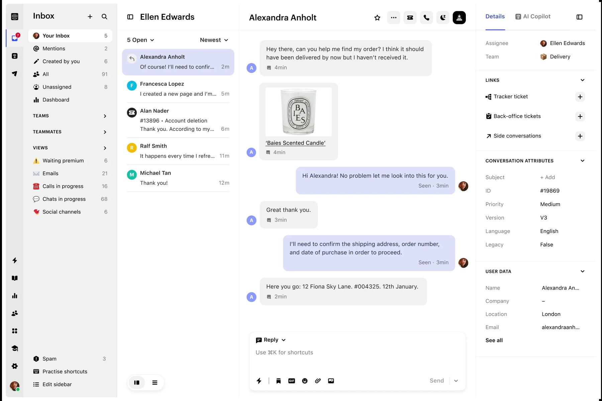

**V:** ürün navigasyonu, konuşma listesi, mesaj alanı ve müşteri ayrıntıları aynı çerçevede. Seçili konuşma renk ve konumla belirgin; yazma alanı mesajların devamında. Ekran çok sayıda destek işini birlikte taşıyor. [U01]

**D:** Fin belgeleri bilgi hazırlama, test, kullanım ve insan devrini ilişkili işler olarak ele alıyor. [U02]

**H / aktarım:** Avenlyo'da müşteri kimliği, son mesaj ve yanıt işlemi yakın olmalı. **Koşul:** daha küçük veri modeli, bu örnekteki bütün panelleri gerektirmez. Gönderildi/okundu veya takım bilgisi mevcut değilse bu ayrıntılar taşınmamalı. Statik görsel, dar ekranda veya uzun mesajda başarısını göstermez.

### Front: Navigasyon küçülebilir; işin yeri kaybolmamalı

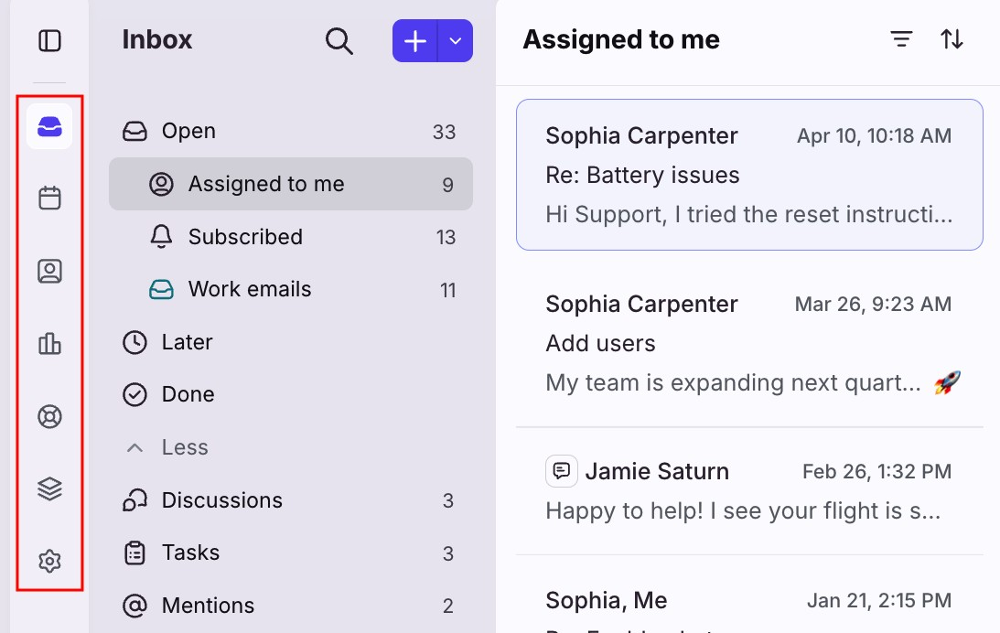

**V:** ürün araçları, iş grupları ve konuşma listesi ayrı katmanlarda. Seçili alanın adı açık; satırlarda kişi, konu ve önizleme sırası var. Kırmızı çerçeve kaynak görselin kendi vurgusudur. [U03]

**D:** güncel yardım, daraltılabilir navigasyonu ve kompakt konuşma başlığını açıklıyor. [U03]

**H / aktarım:** ikincil navigasyon daralabilir; mevcut çalışma yeri metinle anlaşılmalı. Hover ile açılma tek erişim yolu olamaz. Front'un Open/Later/Done modeli Avenlyo'da olmayan çöz/ertele işlemlerini varsayar; bu etiketler kopyalanmamalı.

### Linear: Öncelik, tanımlı bir kapsamla anlam kazanır

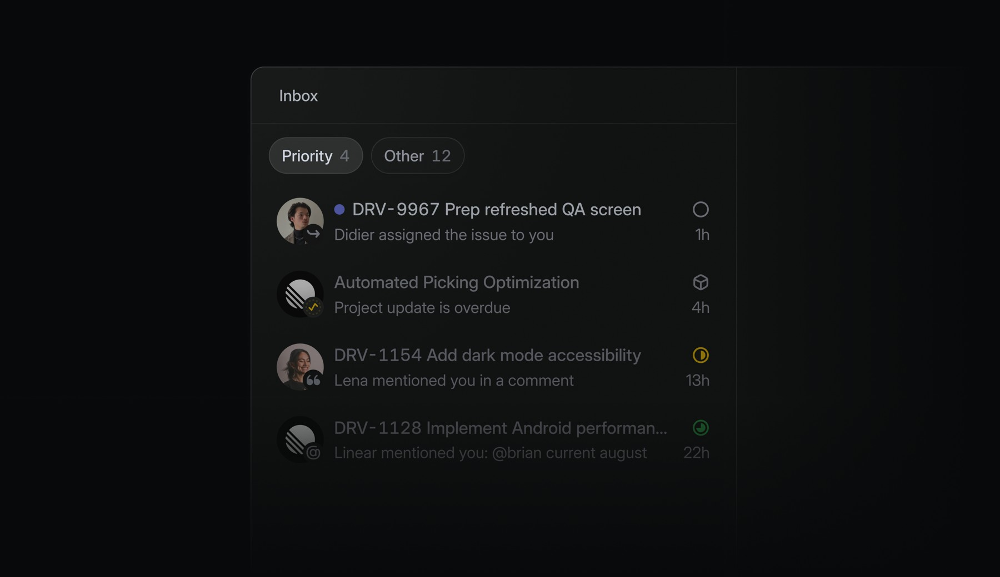

**V:** birincil ve ikincil satır metni, durum simgesi ve zaman farklı ağırlıklarla okunuyor. Görsel tanıtım amaçlı karartma içeriyor; kontrast ölçümü için kullanılamaz. [U04]

**D:** Eylül 2026 güncellemesi dikkat gerektiren bildirimleri ayıran Priority görünümünü açıklıyor. [U04]

**H / aktarım:** Avenlyo'da müdahale gereksinimi açık gerçeklerden türetilebilir. Mevcut snapshot'ın yalnızca bir sayfası yüklüyken “tüm bekleyenler” iddiası kurulamaz. Linear'ın bildirim modeli müşteri konuşmasıyla aynı iş değildir.

### Attio: Kayıt ve ana işlem birlikte okunur

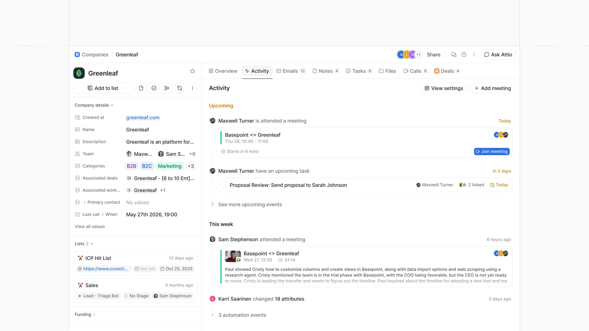

**V:** kaydın adı, temel ayrıntıları ve kayıt işlemleri birbirine yakın. Aktivite ayrı bir ana yüzey; bazı olaylar daraltılmış. [U05]

**D:** Mayıs 2026 yenilemesi, ana işlemleri başlıkla yakınlaştırmayı ve otomasyon olaylarını daraltmayı özellikle anlatıyor. [U05]

**H / aktarım:** talep ayrıntısında müşteri tarafından verilen bilgiler ile konuşmaya dönüş aynı karar alanında bulunmalı. Avenlyo'nun mevcut talebi zengin bir CRM kaydı değildir; kişi birleştirme, pipeline ve otomasyon tarihi eklenmiş gibi gösterilmemeli.

## 05. Yeni nesil AI ürünlerinden alınacak dersler

### Granola: Yapılan iş ekranın asıl yüzeyi olabilir

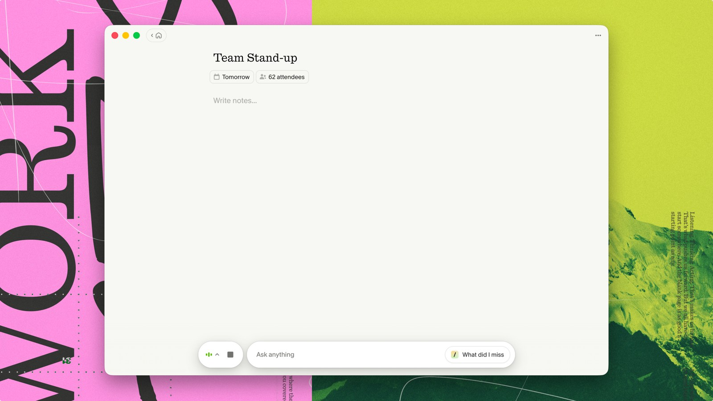

**V:** notun başlığı ve boş yazma yüzeyi baskın; alt bölümde kompakt kayıt/AI kontrolleri bulunuyor. Dıştaki güçlü renkler marka sunumunun arka planı, not yüzeyinin rengi değil. [U06]

**H / aktarım:** konuşmanın kendisi Avenlyo'nun ana çalışma yüzeyi olabilir. Boş alanın değeri, kullanıcının beklediği eylemi destekleyip desteklemediğiyle değerlendirilir. Yeni bir müşteri mesajı bekleyen Inbox, bu not ekranının boş başlangıcını doğrudan benimsememeli.

### Dia: Geçişler ve bağlam çalışma ortamının parçasıdır

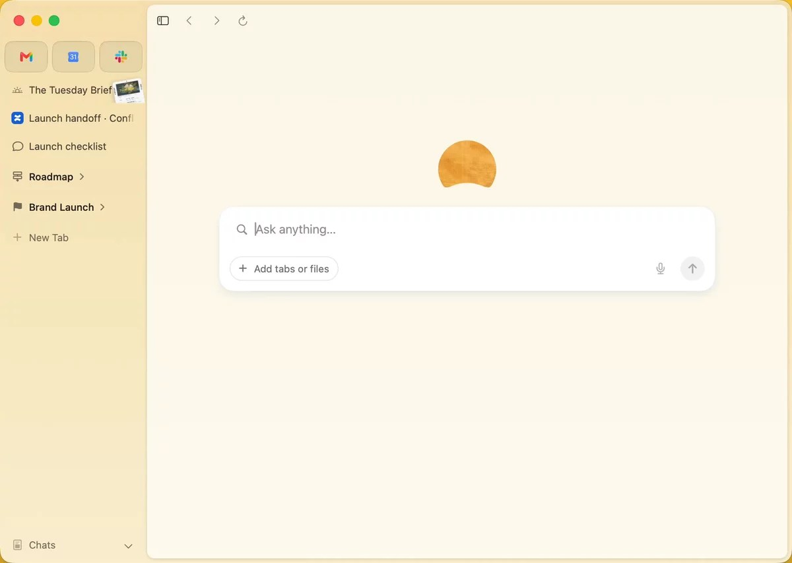

**V:** solda nesneler ve tarayıcı gezintisi; merkezde büyük bir başlangıç işlemi. Bu görüntü genel bir tarayıcı başlangıcıdır. [U07]

**D:** Ekim 2026 sürüm notu, navigasyon ve bölünmüş görünüm davranışına ilişkin güncellemeler sunuyor. Hareket bu turda videodan ölçülmedi. [U08]

**H / aktarım:** açılıp kapanan bağlam, seçili müşterinin ve kullanıcının yerinin kaybolmasına yol açmamalı. Genel bir “her şeyi sor” kutusu Avenlyo'nun mevcut sınırlı ajanını genel amaçlı asistana dönüştürmez.

### Wispr Flow: Kontrolün ömrü, yaptığı işle uyumlu olabilir

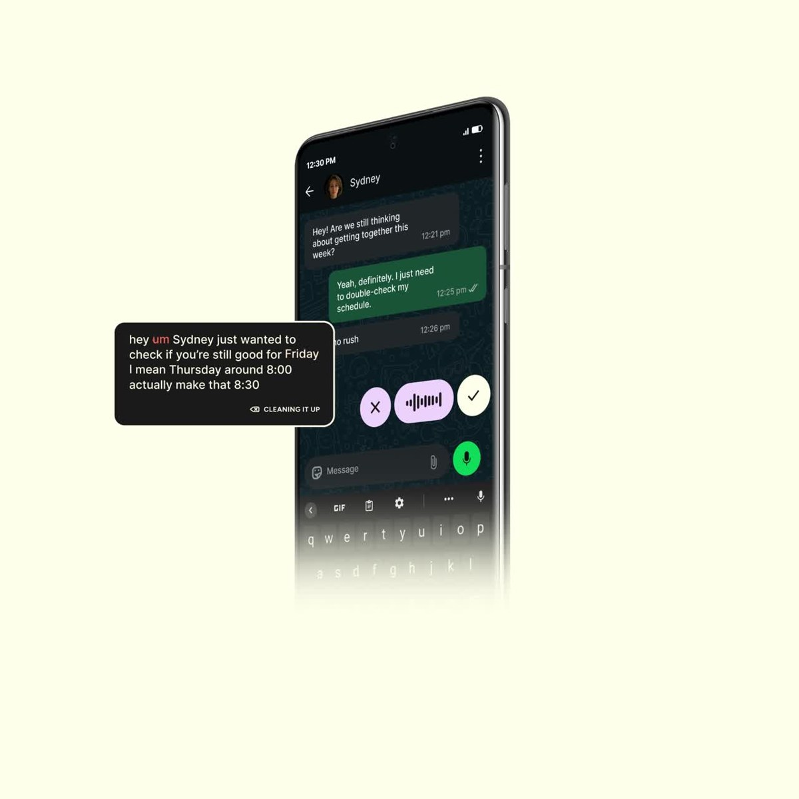

**V:** mesaj yazılan uygulama yerinde kalıyor; dikte kontrolleri işin yakınında ortaya çıkıyor. Açılı telefon sunumu nedeniyle kesin ölçü ve hedef boyutu çıkarılamaz. [U09]

**D:** masaüstü yardımında dinlenme, kayıt ve işleme durumları ayrılıyor; çubuk görünürlüğü ve ekran sınırları ayrıca açıklanıyor. [U10]

**H / aktarım:** devralınmamış konuşmada kısa bir işlem alanı, doğrulanmış sahiplikten sonra yazma alanına dönüşebilir. Bu ders yüzen bir kontrol çubuğu kopyalamayı gerektirmez; önemli olan kontrollerin durumla birlikte anlamlı değişmesidir.

### Superhuman Docs: Çalışma nesnesi ile arayüz katmanı ayrılır

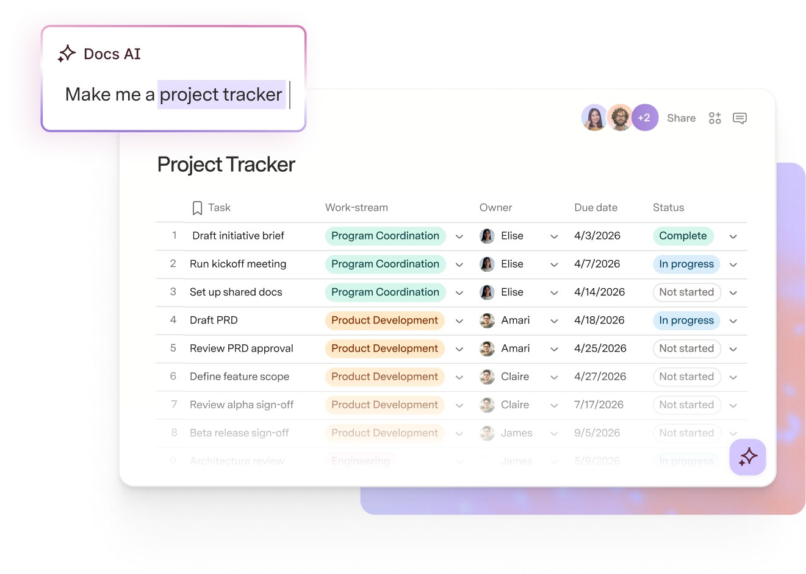

**V:** belge yüzeyi ile AI isteği farklı katmanlarda sunulmuş. Bu tanıtım kesiti tüm uygulama kabuğunu göstermiyor. [U11]

**D:** tasarım ekibi, belgeyi öne çıkaran bir derinlik sistemi kullandığını açıklıyor. [U12]

**H / aktarım:** Knowledge editörü içerik yazmayı, yayın işlemleri ise içeriğin kullanım durumunu temsil etmeli. Her paragrafa kart ve gölge eklemek bu ayrımı güçlendirmez. Katmanlar az ve tutarlı olmalı.

### Superhuman Go: Öneri, etkilediği bilgiye yakın olabilir

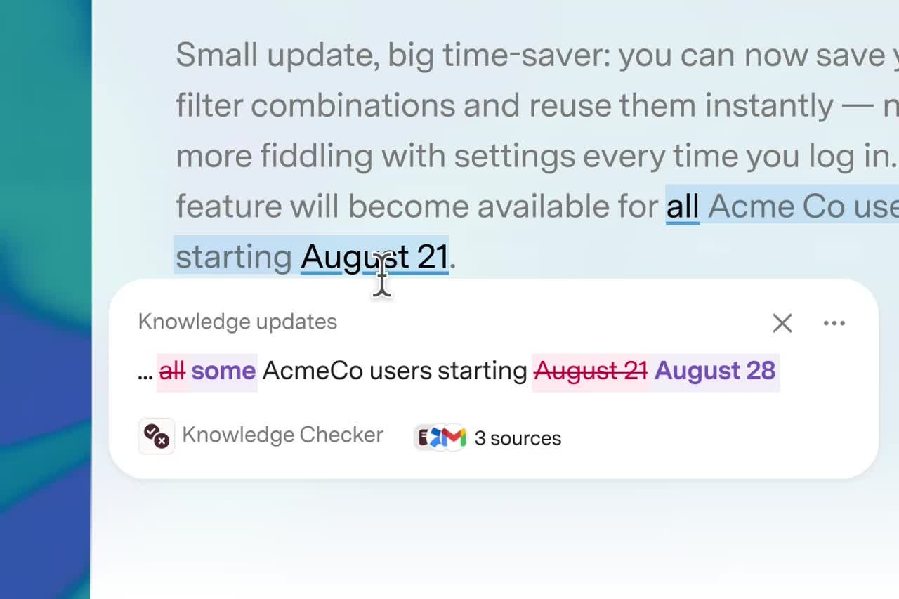

**V:** metinde değişecek parçalar ve önerinin kaynakları aynı yerel alanda görülüyor. Bu tek kare bir önerinin sunumunu gösterir; bütün kabul/reddetme akışını kanıtlamaz. [U13]

**H / aktarım:** Avenlyo'da düzenlenen bilginin taslağa dönüşeceği, editörün kaydetme bağlamında anlatılmalı. Kaynak gösterimi mevcut kaynak kayıtlarıyla sınırlı olmalı. Go'daki genel metin doğrulama veya proaktif öneri yeteneği mevcut özellik sayılmamalı.

### Notion Agent: Mobilde devam eden işin durumu görünürdür

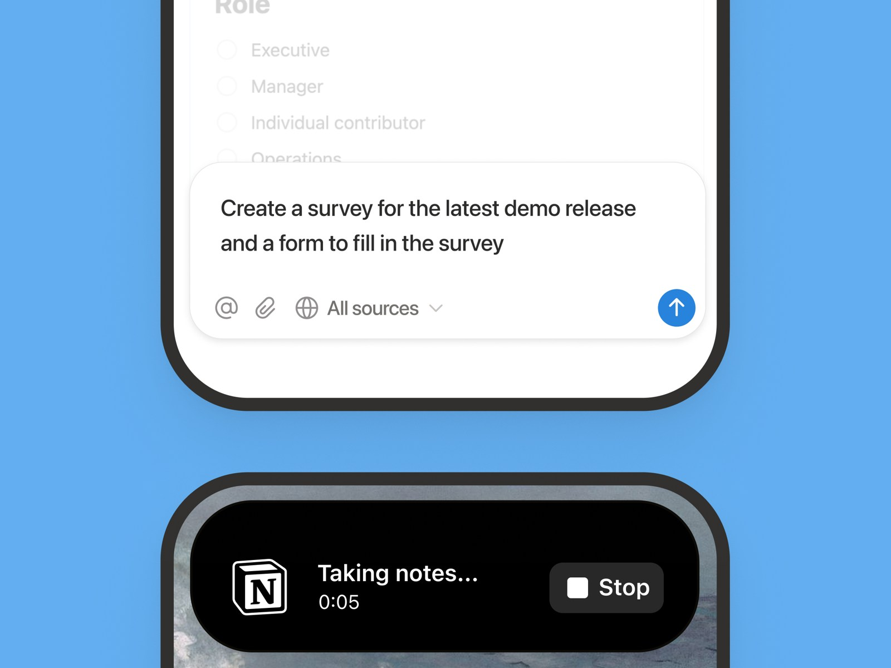

**V:** mobil yazma alanında kaynak kapsamı ve gönderme işlemi; ayrı görüntüde devam eden kayıt ve durdurma kontrolü. Bu kesit bütün mobil navigasyonu göstermez. Görsel Ocak 2026 kaynağına aittir. [U14]

**D:** Şubat ayarlarında ajan erişim/kaynak kontrolü, Ekim güncellemesinde paylaşılan bağlam ele alınıyor. [U15, U16]

**H / aktarım:** aktif işin durumu ve kontrolü küçük ekranda da bulunmalı. Avenlyo'nun izinli kaynakları ve kayıtlı ayarları açıkça anlatılmalı. Çoklu genel ajan, bağlantılı araçlar veya bütün kaynaklarda arama varmış gibi sunulmamalı.

### Yeni Tana: İçerikten çıkan işe geçiş

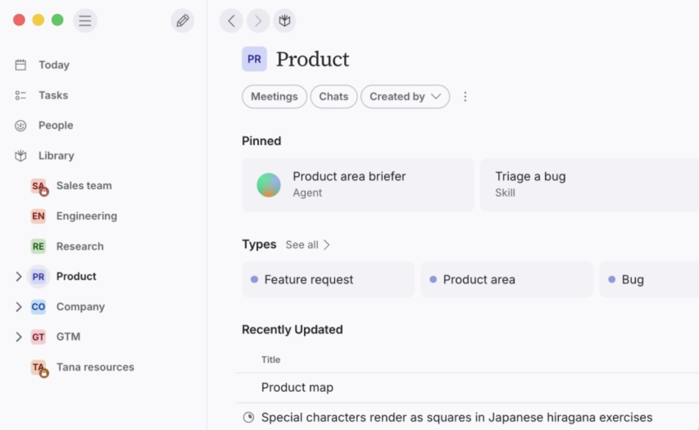

**V:** bir alan içinde sabitlenen işler, türler ve son güncellenen kayıtlar farklı ağırlıkta. Yeni Tana'nın bu yüzeyi eski Outliner'ın aynısı olarak ele alınmadı. [U17]

**D:** güncelleme toplantıdan önerilen sonuçlara ve tek oluşturma alanına geçişi açıklıyor. [U17]

**H / aktarım:** müşteri ilgisi, talep ve konuşma bağlantısı birlikte anlaşılmalı. Her mesajdan görev, otomatik aksiyon veya yeni kayıt üretildiği izlenimi oluşturulmamalı.

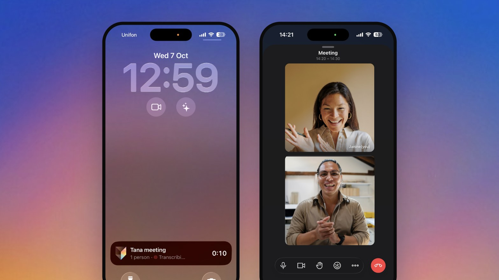

**V/D:** mobil sunum, kilit ekranında devam eden toplantı ve telefon içindeki iş bağlamını gösteriyor. [U18] Avenlyo için ders, mobilde devam eden konuşmaya geri dönüşün kaybolmaması. Bu kaynak web klavyesinin veya Avenlyo mobil yerleşiminin doğrulaması değildir.

### Claude: Kullanıcıya gereksiz mod seçtirmemek

**D:** 16 Eylül 2026 açıklaması, soru sorma ile iş yaptırmayı birleştiren bir deneyim sunuyor; yayılımı belirtilen planlarla sınırlıyor. Bu turdaki kanıt resmî metindir. [U19]

**H / aktarım:** Avenlyo'da “günlük müşteri işi” ve “ajanı hazırlama” kavramsal ayrımı faydalı olabilir; bunun mutlaka yeni bir mod anahtarı gerektirdiği sonucu çıkmaz. Kullanıcı testinde hangi işin nerede olduğunu tahmin etmek zorlaşıyorsa bu ayrım navigasyona taşınmamalı.

## 06. HCI bulgularını Avenlyo kararlarına dönüştürmek

Microsoft'un CHI 2019 çalışması insan-AI etkileşimi için 18 rehber ilke sunar. Aşağıdaki seçim, Avenlyo'ya yönelik uygulama yorumudur; çalışma Avenlyo'nun arayüzünü test etmedi. [R01]

| İlke bağlantısı | Avenlyo için uygulanabilir karşılık |
| --- | --- |
| G1 / sistem kapasitesi | Text/FAQ, kayıtlı ayarlar ve gerçek kanal kapsamını açık anlat. |
| G4 / bağlama uygun bilgi | Yanıt sırasında müşteri mesajı ve yetkiyi; düzenlemede yayın etkisini göster. |
| G8 / müdahaleyi kapatma | Geçerli insan devralma yolunu kolay bulunur kıl. |
| G9 / toparlanma | Belirsiz gönderimde aynı isteği koruyan yeniden deneme. |
| G11 / davranışı açıklama | Yalnızca eldeki kaynak ve durum kanıtını göster; hayali düşünce izi üretme. |
| G16 / işlem sonucu | Bırakmanın AI'ı duraklatılmış tutacağını, sürdürmenin sonraki mesajı etkileyeceğini açıkla. |

Nielsen'in heuristikleri de durum görünürlüğü, kullanıcının dili, tanıma, tutarlılık ve hata toparlanmasını değerlendirmek için yararlı bir çerçeve sağlar. Bunlar genel kurallardır; görev testinin yerine geçmez. [R02]

GOV.UK doğrulama örüntüsünden aktarılabilecek ders; hatayı ilgili alanla ilişkilendirmek, kullanıcının girdisini korumak ve düzeltme yolu göstermektir. GOV.UK'nin tarayıcı doğrulamasını kapatma gibi sisteme özel uygulama tercihlerinin tamamı Avenlyo'ya otomatik taşınmaz. Yetki ve servis hatası da alan doğrulamasıyla karıştırılmamalı. [R03]

## 07. Bilgi görünürlüğü: hangi şey ne zaman görünmeli?

| Bilgi / kontrol | Görünürlük önerisi | Gerekçe ve veri sınırı |
| --- | --- | --- |
| Seçili müşteri ve kanal | Konuşma boyunca görünür | Yanlış konuşmaya yanıt riskini azaltma hipotezi. |
| AI modu ve yanıt yetkisi | Konuşma boyunca erişilebilir ve belirgin | Ana işlemi belirler; sadece tooltip'e konmamalı. |
| Devral / gönder | Duruma göre aynı işlem alanında | Yetki onayından önce yazma açılmaz. |
| Belirsiz gönderim ve aynı isteği tekrar deneme | Çözülene kadar görünür | Başarı bildirimiyle örtülmemeli. |
| Yazılan içerik | Yazma sırasında korunur | Panel değişimi veya ağ hatası girdiyi kaybettirmemeli. |
| Bağlı talep | Kısa bağlantı; ayrıntılar isteğe bağlı | Thread payload'ı id/ad/nitelik içerir; diğer alanlar ek yetkili okuma gerektirir. |
| Mesaj kaynakları | İlgili yanıt bağlamında açılabilir | Mevcut kaynak kayıtları açıklama sınırıdır. |
| Personel email kaydı | İkincil ayrıntı alanı | Müşteriye mesaj teslimatıyla aynı olay değildir. |
| Kurulum durumu | Yeni alanda veya iş engellendiğinde belirgin | Aktif konuşmanın yanında kalıcı kurulum sütunu gerektirmez. |
| Teknik kimlikler / ayrıntılı hata kodu | İhtiyaç halinde teşhis alanı | Ana ürün dilini geliştirici terimleri kaplamamalı. |
| Global okunmamış, SLA, çözülme | Mevcut arayüze eklenmez | Şu an veri/işlem sözleşmesi bulunmuyor. |

Bu ayrım, kontrol sayısını azaltmak için kritik bilgiyi gizleme önerisi değildir. Sıklık ve işlem sonucu belirleyici olmalı. Gerektiğinde açılan bir kontrolün adı, tetikleyicisi ve geri dönüş yolu anlaşılır kalmalı.

## 08. Avenlyo için iş ve dikkat haritası

| İş | Kullanıcının ilk anlaması gereken | Ana işlem | Süreklilik kontrolü |
| --- | --- | --- | --- |
| İlk kurulum | Sıradaki gerçek eksik adım | Bilgi ekle / yayımla / test et | İlerleme gerçek kayıttan gelir; hayali yüzde üretilmez. |
| Müşteriye müdahale | Ne oldu, kim yanıtlayabilir? | Devral ve cevapla | Kimlik, taslak, odak ve okuma yeri korunur. |
| Bilgi güncelleme | Değişiklik yayın kullanımını nasıl etkiler? | Taslak kaydet, ayrı yayımla | İçerik değişiminden sonra yayın durumu açık. |
| Davranış hazırlama | Hangi kontrol ajanı gerçekten etkiler? | Yapılandırılmış ayarı kaydet | Serbest brief ile runtime davranışı karışmaz. |
| Sonucu inceleme | Talep ve iletişim hangi konuşmadan geldi? | Bağlı konuşmayı aç | Müşteri/test ve kanal kaynağı korunur. |

Home her kullanıcı için aynı kart kümesi olmak zorunda değil. Yeni çalışma alanında kurulum; aktif alanda gerçek müşteri işi önce gelebilir. Ancak yüklenen son 50 konuşma üzerinden hesaplanan alt küme, çalışma alanının tüm bekleyen iş sayısı gibi sunulmamalı. [K01]

## 09. İki farklı çalışma modeli

### H1: Konuşma çalışma alanı

Seçili müşteri konuşması ana yüzeyi oluşturur. Kuyruk açık adlandırılmış bir kontrolle geri çağrılır; geniş ekranda yanında kalabilen bir görünüm de denenir. Bağlam yerel bir ayrıntı alanında açılır. Devralma açıklaması, onaylanmış sahiplikten sonra yazma alanına dönüşür.

**Beklenen fayda:** uzun mesajı okuma ve yanıtlamaya alan. **Yanlışlama koşulu:** kullanıcı sıradaki işi kaybediyor veya bir önceki müşteriye dönmek için kontrol arıyorsa hipotez zayıflar.

### H2: Konuşmanın kuyruk içinde açılması

Çalışma alanı gerçek konuşmalardan oluşan sürekli listedir. Bir kayıt açıldığında aynı konumda geniş bir okuma/yazma alanına dönüşür. Başlık ve işlem alanı açık kayda bağlı kalır. Mobilde açık kayıt odaklı tam sayfaya geçebilir.

**Beklenen fayda:** kısa, tekrarlanan müdahalelerde kuyruk konumunu koruma. **Yanlışlama koşulu:** uzun konuşmalar listeyi istikrarsız hale getiriyor, yanlış müşterinin işlemi yapılıyor veya klavye açıkken başlık kayboluyorsa hipotez zayıflar.

| Karşılaştırılacak görev | H1 için risk | H2 için risk |
| --- | --- | --- |
| Arka arkaya üç konuşma | Kuyruğu fazla açıp kapama | Fazla genişleyen liste ve kaydırma. |
| Uzun geçmiş okuma | Geri dönülecek kuyruğun kaybolması | Açık kaydın liste içinde aşırı uzaması. |
| Müşteri ayrıntısını kontrol | Panel açılırken metnin sıkışması | Aynı satırın çok fazla bilgi taşıması. |
| Mobilde yanıt | Kuyruk/konuşma geri dönüşü | Açık kaydın sayfa değişiminde kimliği. |
| Belirsiz gönderimden dönme | Taslak ve isteğin korunması | Başka kaydı açarken bekleyen isteğin karışması. |

Mevcut iki sütunlu kuyruk/konuşma modeli bir kontrol koşulu olarak karşılaştırılabilir. Araştırma henüz H1 veya H2'yi kazanan ilan etmiyor. Önceki raporun konuşma odaklı önerisi bir hipotez olarak sürüyor.

## 10. Ekran aileleri için tasarım kararları

| Yüzey | Tasarım brief'i | Sınanacak soru |
| --- | --- | --- |
| Home | Çalışma alanının o anki işiyle başla; kurulum ve operasyon sırasını ayır. | Kullanıcı neden burada olduğunu ve ilk adımı açıklayabiliyor mu? |
| Inbox | Müşteri, mesaj ve yetkiyi birlikte sun; tek anlamlı ana işlem. | Kimin yanıtlayabileceği ilk okumada anlaşılıyor mu? |
| Talepler | Kanıtlı iletişim ve hizmet ilgisi; konuşmaya yakın dönüş. | Talep ile müşteri kimliği doğrulamasını karıştırıyor mu? |
| Agent | Yapılandırılmış davranış kontrolü, kaydetme durumu, kayıtlı ayarla test. | Serbest brief'in rolü ve testin kullandığı sürüm anlaşılıyor mu? |
| Knowledge | Liste tarama ve içerik yazma için farklı düzen; ayrı yayın işlemi. | Taslak kaydetmekle yayımlamak ayrılıyor mu? |
| Channels | Gerçek kanal durumu ve uygulanabilir sonraki adım. | Website Ready ile mesaj alınmış olmasını ayırıyor mu? |
| Test Agent | Test bağlamı, kısa senaryo başlangıcı, kayıtlı ayarlar. | Test kaydını gerçek müşteri işi sanıyor mu? |
| Auth / workspaces | Kısa formlar, girdiyi koruyan hata ve açık işletme seçimi. | İç altyapı bilgisine ihtiyaç duymadan ilerliyor mu? |
| Widget | İşletme sorusu, mesaj ve insan bekleme hali; host siteye uygun boyut. | Klavyeyle açma/kapatma ve yeniden deneme anlaşılır mı? |

Bir hata durumunda yerel migration kurulumu gibi teşhisler ana kullanıcı mesajı olmamalı. Girdi hatası, yetki eksikliği, geçici bağlantı kaybı ve sonucu bilinmeyen gönderim farklı açıklama ve toparlanma gerektirir.

## 11. Görsel kimlik ve tipografi araştırması

**Amaç:** yoğun kullanıma uygun, ayırt edilebilir ve tutarlı bir çalışma ortamı. Nihai logo, palet veya font bu raporla seçilmedi.

| Karar alanı | Önerilen çalışma | Değerlendirme ölçütü |
| --- | --- | --- |
| Tipografi | Inter, Geist ve Instrument Sans'ı aynı Türkçe içerik ve ölçülerle karşılaştır. | Okuma, tarama, rakam ayrımı, Türkçe glifler, satır kırılması. |
| Hiyerarşi | Başlık, mesaj, metadata ve işlem metnini dört açık rolle kur. | Kullanıcı satırdan müşteriyi, durumu ve zamanı ayırabiliyor mu? |
| Renk | Marka vurgusunu durum anlamlarından ayır; az sayıda semantik token. | AI durmuş ile hata aynı renk yüzünden karışıyor mu? |
| Yüzey | Ana iş yüzeyi, ikincil alan ve açılan katman farklı işlev taşısın. | Ayrım içerik ilişkisini açıklıyor mu? |
| Boşluk | Liste için tarama ritmi, konuşma için okuma ritmi. | Aynı ekranda hem kaybolmuş boşluk hem sıkışmış yazı oluşuyor mu? |
| İkon | Tutarlı aile ve gerektiğinde metin etiketi. | Yeni kullanıcı yalnızca ikona dayanarak işlem tahmin etmek zorunda mı? |
| Karakter | Oran, köşe, çizgi ve dilde tekrarlanabilen kararlar. | Ürün kimliği hata ve loading durumlarında da devam ediyor mu? |

PDF'teki tipografi sayfası aynı test içeriğinin üç fontla karşılaştırılmasıdır. Fontların örnekteki varsayılan yüzleri kullanılır; bu sayfa tüm ağırlıkları, platform rendering'ini veya erişilebilirliği doğrulamaz. Font lisans kaynakları mevcut araştırma branchindeki OFL dosyalarıdır.

Önerilen başlangıç aralıkları: mesaj 14-16px, ikincil bilgi 12-13px; bunlar tasarım deneme değerleridir. Kontrast, zoom ve gerçek cihaz incelemesi ayrıca gerekir. Font boyutunu tek başına kalite ölçütü yapmak doğru değildir.

## 12. Etkileşim: durum değişince arayüz ne yapmalı?

| Geçiş | Görsel/etkileşim sonucu | Korunacak gerçek |
| --- | --- | --- |
| Devralma başladı | İşlem beklemesi; yazma henüz açılmaz | Sunucu onayı yetkiyi belirler. |
| Devralma onaylandı | Aynı bölgede yazma açılır; uygun odak | AI durmuş kalır. |
| Gönderim doğrulanamadı | İçerik ve aynı isteği tekrar deneme görünür | Yeni kimlikle ikinci gönderim oluşturulmaz. |
| Konuşma bırakıldı | Kısa durum güncellemesi | AI durmuş kalır. |
| AI açıkça sürdürüldü | Sonraki müşteri mesajına ilişkin açıklama | Atama temizlenir; geçmişe otomatik yanıt üretilmez. |
| Bağlam açıldı | Seçili kayıt ve okuma konumu korunur | Yeni kaynak/iletişim alanı uydurulmaz. |
| Bilgi düzenlendi | Taslak ve yeniden yayımlama etkisi görünür | Eski yayın kullanılıyor izlenimi verilmez. |

Hareketin işi, açılan yerin ve değişen durumun anlaşılmasını desteklemek. İlk deneylerde kısa panel geçişleri ve reduced-motion alternatifi yeterli olabilir. Bu tur rakip animasyon süreleri veya gecikmeleri ölçülmedi. Yapay AI düşünme adımları, güven yüzdesi ve gerekçesiz ilerleme göstergesi üretilmemeli.

## 13. Mikro metin kararları

Bunlar Türkçe örneklerdir; ürünün ilk arayüz dili henüz seçilmedi.

| Durum | Önerilen metin adayı | Açıklama |
| --- | --- | --- |
| AI durmuş, atama yok | Ekip yanıtı bekleniyor. Yanıtlamak için devralın. | Durum ile yapılabilir işlem birlikte. |
| Kullanıcı devraldı | Bu konuşmayı siz yönetiyorsunuz. AI yanıtları duraklatıldı. | Yetki ve AI modu ayrı ama yakın. |
| Başka üyeye atanmış | Konuşmayı başka bir ekip üyesi yönetiyor. | İsim verisi yoksa isim üretilmez. |
| Bırakma sonucu | Konuşma bırakıldı. AI yanıtları duraklatılmış durumda. | Sürdürmeyle karışmaz. |
| Sürdürme sonucu | AI, müşterinin sonraki mesajına yanıt verebilir. | Geçmişteki mesaja cevap vaadi yok. |
| Website yanıtı kaydedildi | Yanıt kaydedildi ve ziyaretçinin erişimine açıldı. | Okundu iddiası yok. |
| Instagram kabul etti | Instagram mesajı kabul etti. | Teslim/okundu iddiası yok. |
| Sonuç belirsiz | Gönderim sonucu doğrulanamadı. Aynı mesajın sonucunu yeniden kontrol edin. | Yeni mesaj yazdırmak yerine güvenli isteğe dönüş. |
| Bilgi kaydı | Taslak kaydedildi. Ajanın kullanması için yayımlayın. | Yayın sonucu açık. |
| Bilgi düzenleme etkisi | Bu değişiklik kaydedildiğinde içerik taslağa döner. | Sonuç işlemden önce anlaşılır. |
| Veri yüklenemedi | Konuşmalar yüklenemedi. Tekrar deneyin. | Sıfır iş veya tamamlandı mesajı gösterilmez. |

## 14. Mobil, erişilebilirlik ve davranış eşitliği

Telefon, daha az özellikli bir ekran olmamalı. Aynı kritik müdahale tamamlanabilmeli; yerleşim değişebilir. Kuyruk ile konuşma arasında geçişte seçili müşteri, okuma konumu ve bekleyen istek korunmalı.

Mobil kontrol listesi: 390 ve 360px genişlik; 320 CSS px reflow; uzun Türkçe ad/email; sanal klavye açık gönderim; emoji ve Türkçe karakter byte sınırı; metin büyütme; fiziksel klavye; IME; bağlantı kesilmesi; geri/ileri; panel açma ve odak geri dönüşü.

WCAG 2.2 AA hedefi için metin kontrastı, görünür odak ve hedef boyutu birlikte incelenmeli. Normal metin için 4.5:1, büyük metin için 3:1; hedef boyutunda AA kriteri 24x24 CSS px veya geçerli istisnalar. Sık mobil işlemler için 44x44 tasarım hedefi seçilebilir; AA minimumu diye sunulmamalı. [R04]

Modal panel seçilirse odak içeride yönetilir, Escape çalışır ve kapanışta uygun tetikleyiciye döner. Masaüstünde modal olmayan bir widget'a yanlış modal davranış verilmemeli. [R05]

Otomatik erişilebilirlik taraması; klavye, ekran okuyucu ve gerçek cihaz incelemesiyle tamamlanmalı. Bu rapor erişilebilirlik sertifikası veya tamamlanmış cihaz testi değildir. [R06]

## 15. Araştırmadan tasarıma: karar günlüğü

| Karar | Durum | Kanıt / gerekçe | Yeniden değerlendirme koşulu |
| --- | --- | --- | --- |
| Yanıt yetkisi sürekli anlaşılır olacak | Ürün sözleşmesi ve güçlü tasarım gereği | K; R01/R02 | Görev sırasında kimin yanıtlayacağı karışıyorsa sunum değişir. |
| Kalıcı dört sütun zorunlu olmayacak | H | V; veri miktarı daha sınırlı | Kuyruk kaybı veya ayrıntı arama maliyeti artarsa tekrar açılır. |
| Devralma ile yazma aynı işlem bölgesinde denenecek | H, yüksek öncelik | Durum/işlem yakınlığı | Değişen bölge keşfedilemiyor veya odak kayboluyorsa düzenlenir. |
| Test ve müşteri işi ayrılacak | K; veri okuma düzenlemesi gerekir | Mevcut ana ekran ve listelerin kapsamı | Ayrım gerçek kullanıcı görevlerini engelliyorsa erişim yolu iyileştirilir. |
| Kaynak/teknik ayrıntı isteğe bağlı olacak | H | V/D; sınırlı payload | Ana iş sık sık bu bilgiyi gerektiriyorsa görünürlük artar. |
| Yeni bir “Operate/Prepare” modu otomatik eklenmeyecek | H | Gereksiz mod seçimi riski | Kullanıcılar işleri bu ayrıma göre daha kolay bulursa denenir. |
| Font/palet seçimi bu raporda kilitlenmeyecek | Araştırma aşaması kararı | Yapı henüz karşılaştırılmadı | Yerleşim kararı sonrası gerçek içerikle değerlendirme. |
| Okunmamış, çöz/ertele, SLA ve AI güven skoru çizilmeyecek | K; yeni özellik sınırı | Mevcut veri/işlem yok | Ayrı ürün ve API kapsamına alınırsa tasarlanır. |

## 16. Kullanıcı araştırması ve prototip test protokolü

### Örneklem ve görevler

İlk biçimlendirici tur için 6-8 kişi önerilir: ürüne yeni işletme sahipleri ile müşteri mesajlarını düzenli yöneten kişiler. Ekip üyesi/owner farkı da kapsanmalı. Bu sayı istatistiksel temsil veya evrensel tasarım üstünlüğü iddiası için kullanılmaz.

İki prototipte aynı kurgu veri ve durumlar kullanılır. Sıra etkisini azaltmak için katılımcıların yarısı H1, yarısı H2 ile başlar. İçerik ve görev sırası mümkün olduğunca eşleşir. Test sırasında yardım verildiğinde kayda geçer. Gerçek backend yerine simülasyon kullanılırsa açıkça belirtilir.

| Görev | Başarı gözlemi | Kritik hata |
| --- | --- | --- |
| İnsan bekleyen müşteri işini bul | İlgili konuşmayı ve neden işlem gerektiğini açıklar | Yanlış müşteri veya alt kümeyi tüm kuyruk sanma. |
| Devral ve cevap yaz | Onaydan sonra doğru yazma alanını kullanır | Yetkiyi yanlış yorumlama. |
| Sonuç belirsizken devam et | Aynı mesajı koruyan tekrar yolunu seçer | Yeni mesajla çoğaltma. |
| Bırak / AI'ı sürdür farkını anlat | Her ikisinin etkisini doğru söyler | Bırakınca AI çalışır sanma. |
| Bir bilgiyi güncelle | Taslak ve yayın etkisini doğru açıklar | Kaydetmeyi yayımlama sanma. |
| Başka konuşmaya geç ve geri dön | Müşteri, taslak ve konum korunur | Bekleyen isteğin müşteriyle karışması. |
| Mobilde aynı müdahaleyi tamamla | Klavye açıkken kontrol ve dönüş yolu bulunur | Gönderimin veya geri dönüşün kaybolması. |

### Ölçüm ve karar

Yönlendirmesiz görev tamamlama, kritik hata, yardım ihtiyacı, ilk anlamlı işlem, geri dönüş adımları, görev süresi ve kullanıcının durum açıklaması kaydedilir. Her görev sonrası 1-7 kolaylık sorusu kullanılabilir; bu yerel araştırma puanı standartlaştırılmış norm veya sektör kıyası sayılmamalı.

Önerilen karar kuralı: önce kritik yanlış anlama ve veri/işlem güvenliği; sonra yardım ihtiyacı ve süreklilik; daha sonra süre ve estetik tercih. Tek kritik hata örneği bile tasarımın ilgili bölümünü yeniden incelemek için yeterli olabilir. Küçük örneklemde birkaç saniyelik farkla kazanan ilan edilmemeli.

İlk turdan sonra yeni katılımcılarla bir doğrulama turu yapılmalı. “5 kullanıcı bütün sorunları bulur” gibi bir garanti kullanılmaz. Araştırmanın amacı hangi hipotezin hangi koşulda işe yaradığını öğrenmek.

### Görüşmede öğrenilecek bağlam

Günlük mesaj hacmi; telefondan müdahale sıklığı; aynı anda kaç konuşma yönetildiği; gerçek bir devralma örneği; mesaj kaçırmanın sonucu; kullanılan iş terimleri; bilgi güncelleme sıklığı; sonucun belirsiz kaldığı gönderimde beklenen davranış; test ile gerçek kullanım ayrımı; yetki ve ekip sorumluluğu.

## 17. Bir sonraki somut tasarım paketi

1. Aynı içerik ve görevlerle H1/H2 için düşük ayrıntılı yerleşimler.
2. Her yerleşimde AI aktif, insan bekleyen, kullanıcıya atanmış, başka üyeye atanmış, belirsiz gönderim ve bağlantı hatası durumları.
3. Home için ilk kurulum ve aktif operasyon varyantları; Agent için kayıtlı/kaydedilmemiş ayar ayrımı.
4. Mobilde kuyruk dönüşü, ayrıntı açma ve klavye açık yanıt akışı.
5. Seçilen yapı üzerinde tipografi ve görsel kimlik karşılaştırması.
6. Görev testindeki gözlemlerle güncellenen karar günlüğü.

Bu turda Avenlyo uygulama kodu, bağımlılıklar, API veya veri tabanı değiştirilmedi. Üretilenler araştırma belgesi, görsel rapor ve kaynak kayıtlarıdır. Teknoloji ve test komutlarının ayrıntısı ilk raporda korunuyor.

## 18. Kaynaklar ve kullanım kapsamı

Resmî sayfalar 18 Ekim 2026 araştırmasında okundu. İlk turda aynı gün incelenen kaynaklar yeniden kullanılabilir; görsellerin edinim ve kaynak tarihleri manifestte ayrıdır. Tarihli sürüm notları, yayımlandıkları değişiklik bağlamında yorumlandı.

| Kimlik | Kaynak | Bu rapordaki kullanım |
| --- | --- | --- |
| U01 | [Intercom Inbox](https://www.intercom.com/helpdesk/inbox) | Çok bölmeli konuşma yüzeyi; V/D. |
| U02 | [Fin AI Agent](https://fin.ai/help/en/articles/13975995-fin-ai-agent-explained) | Bilgi, test ve devralma ilişkisi; D. |
| U03 | [Front Inbox](https://help.front.com/en/articles/3889728) | Navigasyon, liste, kompakt başlık; V/D. |
| U04 | [Linear Priority Inbox](https://linear.app/changelog/2026-09-03-priority-inbox) | Eylül 2026 öncelik görünümü; V/D. |
| U05 | [Attio kayıt sayfası](https://attio.com/changelog/2026/record-page-redesign) | Mayıs 2026 kayıt/işlem ilişkisi; V/D. |
| U06 | [Granola görsel yenileme](https://www.granola.ai/blog/a-new-look-for-granola) | Not yüzeyi ve kimlik; V/D. |
| U07 | [Dia ürün yüzeyi](https://www.diabrowser.com/) | Başlangıç/poster görüntüsü; V. |
| U08 | [Dia 1.53.0](https://www.diabrowser.com/changelog/mac/1-53-0) | Ekim 2026 sürüm notu; D. |
| U09 | [Wispr Flow Android](https://wisprflow.ai/android) | Resmî demo karesi; V. |
| U10 | [Wispr Flow kontrol çubuğu](https://docs.wisprflow.ai/articles/1790396454-move-and-dock-the-flow-bar-on-desktop) | Durumlar ve görünürlük; D. |
| U11 | [Superhuman Docs](https://superhuman.com/docs) | Ürün kesiti; V. |
| U12 | [Docs tasarım süreci](https://blog.superhuman.com/docs-new-visual-identity/) | Derinlik sistemi; D. |
| U13 | [Superhuman Go 1.0](https://blog.superhuman.com/go-1-0/) | Yerel öneri ve kaynak ilişkisi; V/D. |
| U14 | [Notion mobil Agent](https://www.notion.com/releases/2026-01-20) | Mobil yazma/kayıt kesiti; V. |
| U15 | [Notion Custom Agents](https://www.notion.com/releases/2026-02-24) | Kaynak/erişim kontrolü; D. |
| U16 | [Notion bağlam güncellemesi](https://www.notion.com/releases/2026-10-13) | Ekim 2026 bağlam yaklaşımı; D. |
| U17 | [Yeni Tana güncellemesi](https://tana.inc/blog/tana-takes-it-from-here) | Alan, nesne ve sonuç ilişkisi; V/D. |
| U18 | [Tana iOS](https://tana.inc/blog/tana-app-for-ios) | Mobil devam eden iş; V/D. |
| U19 | [Birleşik Claude](https://claude.com/resources/articles/cowork-is-now-claude) | Eylül 2026 mod birleştirme; D. |
| R01 | [Amershi vd., CHI 2019](https://www.microsoft.com/en-us/research/publication/guidelines-for-human-ai-interaction/) | İnsan-AI ilkeleri; yayımlanmış araştırma. |
| R02 | [Nielsen kullanılabilirlik heuristikleri](https://www.nngroup.com/articles/ten-usability-heuristics/) | Uzman değerlendirme çerçevesi. |
| R03 | [GOV.UK hata toparlanması](https://design-system.service.gov.uk/patterns/validation/) | Form girdi/hata ilişkisi. |
| R04 | [WCAG 2.2 Quick Reference](https://www.w3.org/WAI/WCAG22/quickref/) | Erişilebilirlik hedefleri. |
| R05 | [WAI-ARIA Modal Dialog](https://www.w3.org/WAI/ARIA/apg/patterns/dialog-modal/) | Modal odak ve klavye davranışı. |
| R06 | [Playwright erişilebilirlik](https://playwright.dev/docs/accessibility-testing) | Otomatik ve manuel incelemenin birlikte kullanımı. |
| K01 | [İncelenen kaynak sürümü](https://github.com/ismet3547/avenlyo-app/tree/ed945629cfe04b7097c6a94e8699603f2b9b5792) | Mevcut ürün, veri ve işlem sınırları. |

Görseller ilgili ürünlerin sahiplerine aittir; atıflı karşılaştırmalı araştırma amacıyla kullanılır. Avenlyo'nun üretim arayüzüne taşınacak lisanslı tasarım varlıkları olarak sunulmaz. Genel ürün sayfası erişilebilirliği, bütün etkileşimlerin doğrulandığı anlamına gelmez.
